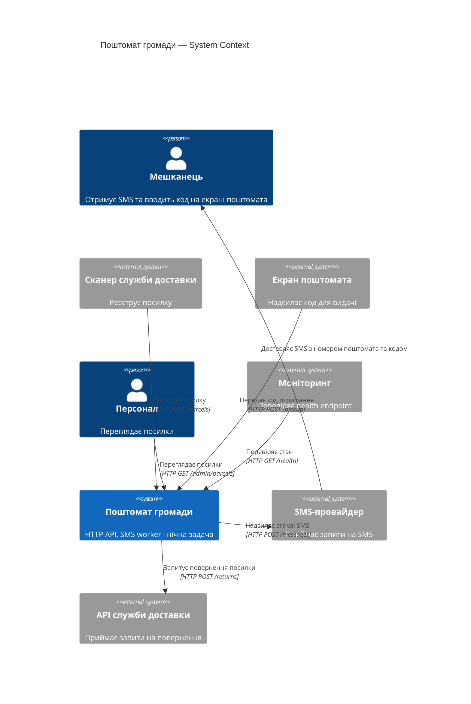
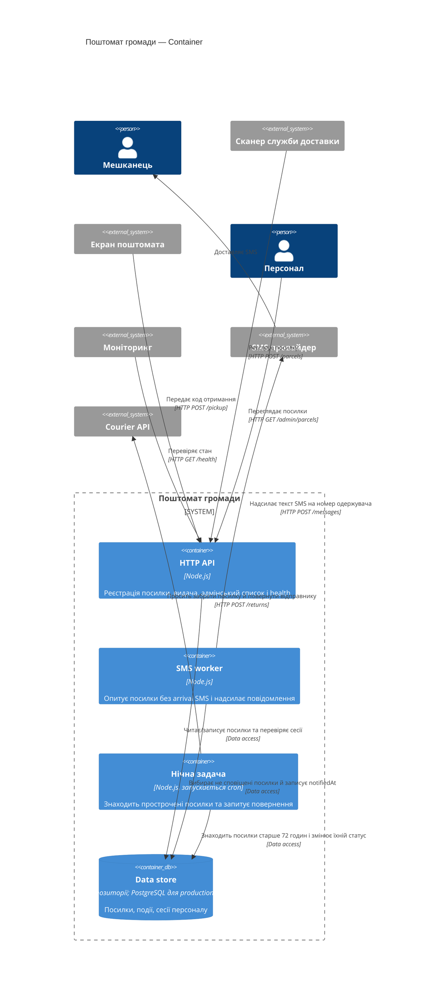

# Архітектура «Поштомата громади» — C4

Діаграми відображають реалізацію в `app/`. Зовнішні клієнти показані лише там, де їхню взаємодію видно в HTTP-обробниках або коментарях коду. Часова задача запускається зовнішнім cron; сам cron не є частиною процесу застосунку.

## Рівень 1 — System Context

## Рівень 2 — Container

## Стрілки і докази

Кожен рядок відповідає одній декларації `Rel` — включно з тими самими взаємодіями, які намальовані окремо на обох рівнях. Статус «Є» допускає назву-синонім або явно заявлену в AI-відповіді модель екрана поштомата як клієнта мешканця; пояснення зазначене в клітинці. Зовнішню доставку SMS підтверджує контракт провайдера, але `app/` доводить лише HTTP-запит до нього, а не факт доставки.

| # | Рівень | Стрілка (звідки → куди: що і як) | Доказ (`файл:рядок`) | AI з документації | AI з коду |
|---|---|---|---|---|---|
| 1 | System Context | Сканер → Поштомат громади: реєстрація, `POST /parcels` | `app/src/server.js:38-40`; scanner згадано в `app/src/parcels.js:34-35` | Є — `delivery → locker` | Є — `courier → locker` реєструє посилки |
| 2 | System Context | Екран поштомата → Поштомат громади: код видачі, `POST /pickup` | `app/src/server.js:42-45`; `app/src/parcels.js:58-61` | Є — мешканець поданий як клієнт екрана | Є — таке саме явне припущення про клієнта мешканця |
| 3 | System Context | Персонал → Поштомат громади: список посилок, `GET /admin/parcels` | `app/src/server.js:47-49` | Є | Є |
| 4 | System Context | Моніторинг → Поштомат громади: health, `GET /health` | `app/src/server.js:36-37` | Є | Є |
| 5 | System Context | Поштомат громади → SMS-провайдер: запит arrival SMS | `app/src/worker.js:11-13,28`; `app/src/sms.js:27-44` | Є — `locker → sms` | Є — `locker → sms` |
| 6 | System Context | SMS-провайдер → мешканець: доставка SMS | Контракт API й delivery reports: `materials/vendors/sms-provider.md:13-18`; застосунок передає `to` і `text`: `app/src/sms.js:31-35` | Пропустив — натомість є вигадана `locker → resident` | Пропустив — окремої стрілки від провайдера до мешканця немає |
| 7 | System Context | Поштомат громади → Courier API: запит повернення, `POST /returns` | `app/bin/expire-parcels.js:15`; `app/src/courier.js:3-18` | Пропустив | Пропустив — у Context описано `courier → locker`, напрямок запиту повернення зворотний |
| 8 | Container | Сканер → HTTP API: реєстрація, `POST /parcels` | `app/src/server.js:38-40`; `app/src/parcels.js:34-35` | Є — `delivery → api` | Є — `courier → api` реєструє посилки |
| 9 | Container | Екран поштомата → HTTP API: передача коду, `POST /pickup` | `app/src/server.js:42-45`; `app/src/parcels.js:58-61` | Є — мешканець поданий як клієнт екрана | Є — таке саме явне припущення про клієнта мешканця |
| 10 | Container | Персонал → HTTP API: список, `GET /admin/parcels` | `app/src/server.js:47-49` | Є | Є |
| 11 | Container | Моніторинг → HTTP API: health, `GET /health` | `app/src/server.js:36-37` | Є | Є |
| 12 | Container | HTTP API → сховище: посилки й сесії | `app/src/server.js:13-19,38-49`; `app/src/parcels.js:43-55,61-75` | Є | Є |
| 13 | Container | Worker → сховище: вибір не сповіщених і запис `notifiedAt` | `app/src/worker.js:23-34`; `app/src/db.js:40-44` | Є | Є |
| 14 | Container | Worker → SMS-провайдер: відправка SMS через HTTP | `app/src/worker.js:26-34`; `app/src/sms.js:27-44` | Є | Є |
| 15 | Container | SMS-провайдер → мешканець: доставка SMS | Контракт API й delivery reports: `materials/vendors/sms-provider.md:13-18`; застосунок передає `to` і `text`: `app/src/sms.js:31-35` | Пропустив — `locker → resident` не є `sms → resident` | Пропустив — немає стрілки від провайдера до мешканця |
| 16 | Container | Нічна задача → сховище: прострочені посилки й статус повернення | `app/bin/expire-parcels.js:11-14`; `app/src/parcels.js:78-87` | Є — `expirer → db` | Є — `expiry → db` |
| 17 | Container | Нічна задача → Courier API: запит повернення, `POST /returns` | `app/bin/expire-parcels.js:15`; `app/src/courier.js:3-18` | Пропустив | Є — `expiry → courier` |

## Що AI вигадав / пропустив

| Прогін | Вигадав або переплутав — стрілки, яких немає в коді, чи неправильний напрямок | Пропустив — декларації `Rel` з таблиці вище, яких немає в тому самому вигляді у відповіді AI |
|---|---|---|
| З документації | 2 стрілки: мешканець → поштомат (№2 як людська дія, якої код не показує) і поштомат → мешканець (№6; код показує worker → провайдер, а не пряму доставку з екрана). | 4 декларації: №6 і №15 (SMS-провайдер → мешканець на обох рівнях), №7 (запит до Courier API в Context), №17 (запит до Courier API у Container). |
| З коду | 0 вигаданих стрілок. У Context стрілка `courier → locker` об'єднує реєстрацію з поверненням і задає зворотний напрямок для запиту повернення (№7). | 3 декларації: №6 і №15 (SMS-провайдер → мешканець на обох рівнях), №7 (напрямок запиту до Courier API у Context). Container-стрілка №17 присутня. |

Окремо від стрілок: документаційний прогін повторив застарілі параметри — poll кожні 30 секунд і 4-значний код. Код встановлює 10 секунд (`app/src/worker.js:8,65-66`) та генерує 6 цифр (`app/src/parcels.js:25-28`). Також документація називає PostgreSQL фактичною БД, тоді як `app/src/db.js:1-2` каже, що у цьому репозиторії store in-memory; PostgreSQL описаний як production реалізація того самого інтерфейсу.

**Разом за рівнями:** з документації — вигадано 2 стрілки, пропущено 4 декларації; з коду — вигадано 0 стрілок, пропущено 3 декларації. Два рядки про доставку SMS рахуються окремо, бо `Rel` оголошено і в System Context, і в Container.

## Перевірка меж діаграми

- У коді є `GET /admin/parcels` для персоналу, але немає окремої взаємодії відправника з інтерфейсом статусу повернення; тому такого клієнта на діаграмі немає.
- Worker надсилає arrival SMS. Нагадувань через 24/48 годин у поточному `app/` немає; цієї майбутньої функції на діаграмі немає.
- `app/` не змінювався.
