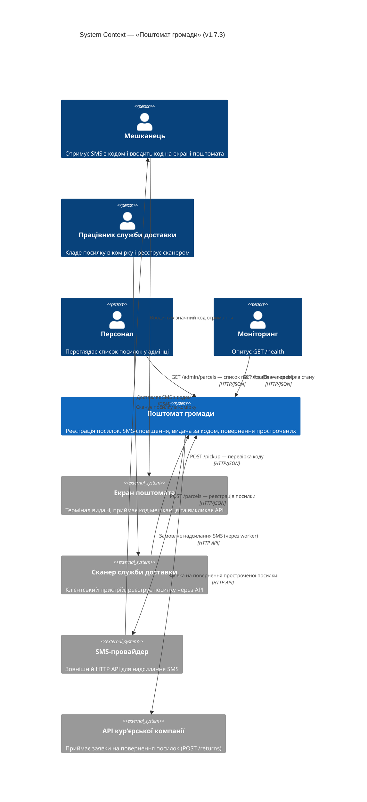
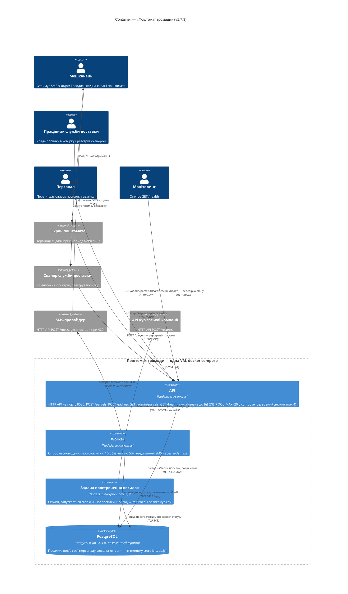

# Архітектура «Поштомата громади» — C4

> Task B. Скопіюйте у `docs/architecture.md`. Діаграми — Mermaid: `C4Context` /
> `C4Container` або `flowchart`. Кожну стрілку перевірте в коді. `app/` не редагуйте.

## Рівень 1 — System Context

## Рівень 2 — Container

## Стрілки і докази

Один рядок — одна стрілка з ваших діаграм. «AI з документації» — результат з `ai-runs/c4-from-docs.md` (бачив лише `app/README.md` і `app/docs/ARCHITECTURE.md`, не бачив коду). «AI з коду» — результат з `ai-runs/c4-from-code.md` (бадив увесь код `app/`).

| # | Стрілка (звідки → куди: що і як) | Доказ (`файл:рядок`) | AI з документації | AI з коду |
|---|---|---|---|---|
| 1 | Мешканець → Екран поштомата: вводить 6-значний код отримання |user-дія, підтверджується потоком `POST /pickup` (`app/src/server.js:42-46`) | документація — 4 цифри, код — 6 (розбіжність) | є |
| 2 | Екран поштомата → API: `POST /pickup` — перевірка коду, HTTP/JSON | `app/src/server.js:42-46` (маршрутний обробник сам по собі не підтверджує TLS) | є | є |
| 3 | Працівник служби доставки → Сканер: сканує посилку в комірку | `app/docs/ARCHITECTURE.md:9-11` (сканер об'єднано з кур'єром — не окрема стрілка системи) | є | пропущено |
| 4 | Сканер → API: `POST /parcels` — реєстрація посилки, HTTP/JSON | `app/src/server.js:38-41` (маршрутний обробник сам по собі не підтверджує TLS) | є | пропущено |
| 5 | Персонал → API: `GET /admin/parcels` — список посилок (Bearer-сесія), HTTP/JSON | `app/src/server.js:47-50` (маршрутний обробник сам по собі не підтверджує TLS) | є | є |
| 6 | Моніторинг → API: `GET /health` — перевірка стану, HTTP/JSON | `app/src/server.js:37` | є | є |
| 7 | API → PostgreSQL: читання/запис посилок, подій, сесій, TCP 5432 | `app/src/server.js:38-39` → `app/src/parcels.js:35-55` → `app/src/db.js:63-101` | є | є |
| 8 | Worker → SMS-провайдер: надсилає SMS про прибуття, HTTP API POST /messages | `app/src/worker.js:28` (`sms.send`), `app/src/sms.js:31` (`fetch /messages`) | є | є |
| 9 | API → API кур'єрської компанії: заявка на повернення простроченої посилки, HTTP API | `app/bin/expire-parcels.js:15` → `app/src/courier.js:7-8` | пропустив — немає `courierApi` в diagramі з документації | є |
| 10 | SMS-провайдер → Мешканець: доставляє SMS з кодом, GSM |зовнішній канал, описано в `materials/vendors/sms-provider.md:13-19` | є | пропущено |
| 11 | Мешканець → Екран поштомата: вводить код отримання (Container) | user-дія, підтверджується `POST /pickup` (`app/src/server.js:42-46`) | є | є |
| 12 | Екран поштомата → API: `POST /pickup`, HTTP/JSON (Container) | `app/src/server.js:42-46` (маршрутний обробник сам по собі не підтверджує TLS) | є | є |
| 13 | Працівник служби доставки → Сканер: сканує посилку (Container) | `app/docs/ARCHITECTURE.md:9-11` (сканер об'єднано з кур'єром — не окрема стрілка системи) | є | пропущено |
| 14 | Сканер → API: `POST /parcels`, HTTP/JSON (Container) | `app/src/server.js:38-41` (маршрутний обробник сам по собі не підтверджує TLS) | є | пропущено |
| 15 | Персонал → API: `GET /admin/parcels`, HTTP/JSON (Container) | `app/src/server.js:47-50` (маршрутний обробник сам по собі не підтверджує TLS) | є | є |
| 16 | Моніторинг → API: `GET /health`, HTTP/JSON (Container) | `app/src/server.js:37` | є | є |
| 17 | API → PostgreSQL: читання/запис посилок, подій, сесій, TCP 5432 (Container) | `app/src/server.js:38-39` → `app/src/parcels.js:35-55` → `app/src/db.js:63-101` | є | є |
| 18 | Worker → PostgreSQL: несповіщені посилки, оновлення `notifiedAt`, TCP 5432 | `app/src/worker.js:24` (`listUnnotified`), `:33` (`updateParcel notifiedAt`) | є | є |
| 19 | Worker → SMS-провайдер: SMS про прибуття, HTTP API `POST /messages` | `app/src/worker.js:28` (`sms.send`), `app/src/sms.js:31` (`fetch /messages`) | є | є |
| 20 | Задача прострочення → PostgreSQL: пошук прострочених, оновлення статусу, TCP 5432 | `app/bin/expire-parcels.js:12` (`findExpired`), `:14` (`markReturned`) | є (як `nightJob → db`) | є |
| 21 | Задача прострочення → API кур'єра: заявка на повернення, HTTP API `POST /returns` | `app/bin/expire-parcels.js:15` (`courier.requestReturn`), `app/src/courier.js:7-8` | пропустив — немає `courierApi` в diagramі з документації | є |
| 22 | SMS-провайдер → Мешканець: доставляє SMS з кодом, GSM (Container) |зовнішній канал GSM, `materials/vendors/sms-provider.md:13-19` (не системне з'єднання в коді) | є | пропущено |

## Що AI вигадав / пропустив

| Прогін | Вигадав — стрілки й компоненти, яких у коді немає (і чим перевірено) | Пропустив — стрілки з таблиці вище, яких немає в AI |
|---|---|---|
| з документації (`c4-from-docs.md`) | - Вказав інтервал worker **30 секунд** (`c4-from-docs.md:72`), але в коді `POLL_INTERVAL_MS = 10_000` (`app/src/worker.js:8`). У `docs/ARCHITECTURE.md:19` також 30 с — це розбіжність документації з кодом. - Показав `nightJob` як окрема контейнер (`c4-from-docs.md:73`), але це cron-скрипт (`bin/expire-parcels.js`), що запускається на VM, а не docker-контейнер. | #9 — API → API кур'єра (немає `courierApi` зовнішньої системи) #21 — Задача прострочення → API кур'єра |
| з коду (`c4-from-code.md`) | - Показав `expire` як окрему контейнер всередині `docker compose` (`c4-from-code.md:76`), але це скрипт, запускається cron на VM, а не сервіс docker compose.<br- Писував "теки `deploy/` не знайдено" (`c4-from-code.md:19`) — не є помилкою: сесія бачила лише ізольовану копію `app/` (`c4-from-code.md:5`), а не повний репозиторій; `deploy/` (`Dockerfile`, `compose.yaml`) існує в повному репозиторії, але не входило в обзор сесії. | #3 — Працівник → Сканер #4 — Сканер → API #10 — SMS-провайдер → Мешканець #13 — Працівник → Сканер (Container) #14 — Сканер → API (Container) #22 — SMS-провайдер → Мешканець (Container) |

**Разом:** з документації — вигадано 2 (невірний інтервал worker, невірний тип nightJob), розбіжність у довжині коду отримання (документація — 4 цифри, код — 6), пропущено 2 (#9, #21); з коду — вигадано 1 (невірний тип expire контейнера); відсутність `deploy/` не рахується як помилка, бо сесія бачила лише `app/` (`c4-from-code.md:5`), пропущено 6 (#3, #4, #10, #13, #14, #22).

## Запропоноване (з ADR) — необов'язково

Нижче показано частину, що запропонована в ADR-0001 (`docs/adr/0001-notifications.md`), а не реалізована в коді. Позначено як «запропоновано».

- `parcel_jobs` — таблиця завдань (outbox) для надійної доставки SMS і повернень, створюється в одній транзакції з посилкою (`docs/adr/0001-notifications.md`, розділ «Рішення» §1).
- `deadlineLoop` і `deliveryLoop` — два цикли worker-а замість поточного простого полінгу (`docs/adr/0001-notifications.md`, розділ «Рішення» §3).
- `parcel_events` — append-only журнал подій без телефонів і кодів (`docs/adr/0001-notifications.md`, розділ «Рішення» §1).
- Зміна `backup-runbook.md`: прибрати глобальний read-only 02:00–02:30, оскільки він блокує `UPDATE` у вікні дедлайну 72 годин (`docs/adr/0001-notifications.md`, розділ «Наслідки» §7).