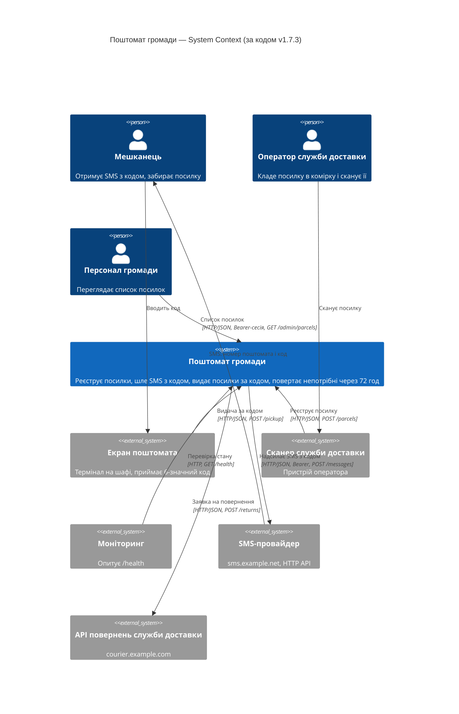
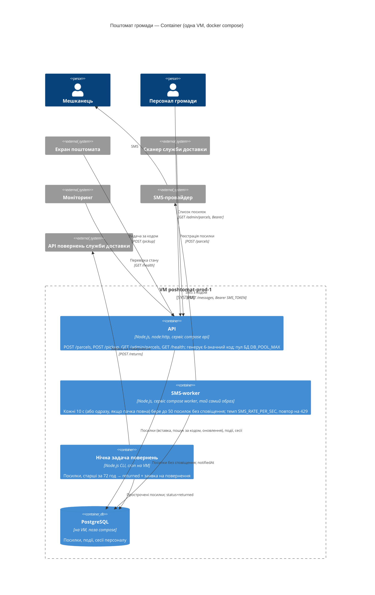

# Архітектура «Поштомата громади» — C4

> Task B. Діаграми — такою система є в коді `app/` (v1.7.3), а не в `app/docs/ARCHITECTURE.md`
> (v1.5, застарів). Кожна стрілка — рядок у таблиці з доказом.

## Рівень 1 — System Context

## Рівень 2 — Container

Примітки: протокол до БД у коді не видно — у репо сховище в пам'яті (`app/src/db.js:1-2`),
PostgreSQL у продакшні — за `app/README.md:23-24` і `app/docs/ARCHITECTURE.md:20`; тому на стрілках
до БД протокол не підписано. API слухає звичайний HTTP (`app/src/server.js:1, 93-95`) — TLS у коді
немає, тому «HTTP», а не «HTTPS».

## Стрілки і докази

«є» — AI намалював цю стрілку; «пропустив» — у його діаграмі її немає.

| # | Стрілка (звідки → куди: що і як) | Доказ (`файл:рядок`) | AI з документації (`ai-runs/c4-from-docs.md`) | AI з коду (`ai-runs/c4-from-code.md`) |
|---|---|---|---|---|
| 1 | Мешканець → Екран поштомата: вводить код | `app/src/parcels.js:58` («The locker terminal sends the code the person typed») | є (але «4-значний код» — у коді 6, `app/src/parcels.js:27, 60`) | є |
| 2 | Екран поштомата → Поштомат / API: видача, `POST /pickup` | `app/src/server.js:42-45` | є | є (з вигаданим «і відчиняє комірку» — API лише повертає `{id, lockerId}`, `app/src/parcels.js:68`) |
| 3 | Оператор → Сканер: сканує посилку | `app/src/parcels.js:34` («Called by the delivery operator's scanner») | є | є |
| 4 | Сканер → Поштомат / API: реєстрація, `POST /parcels` | `app/src/server.js:38-40` | є | є |
| 5 | Персонал → Поштомат / API: `GET /admin/parcels` з `Authorization: Bearer <session>` | `app/src/server.js:13-19, 47-49`; `app/src/parcels.js:72-75` | є | є |
| 6 | Моніторинг → Поштомат / API: `GET /health` | ендпоінт — `app/src/server.js:37`; хто опитує — лише `app/docs/ARCHITECTURE.md:17` | є | є |
| 7 | Поштомат → SMS-провайдер: `POST {SMS_BASE_URL}/messages`, Bearer-токен | `app/src/sms.js:31-35` | є | є |
| 8 | SMS-провайдер → Мешканець: SMS з номером поштомата і кодом на `recipientPhone` | `app/src/worker.js:11-13, 28` | є | є |
| 9 | Поштомат → API повернень служби доставки: `POST {COURIER_BASE_URL}/returns` | `app/src/courier.js:7-16`; `app/bin/expire-parcels.js:15` | **пропустив** — у документації цієї інтеграції немає | є |
| 10 | API → PostgreSQL: вставка посилки, пошук за кодом, оновлення статусу, події, сесії | `app/src/parcels.js:43-55, 61, 64-67, 74`; `app/src/server.js:18` | є | є |
| 11 | Worker → PostgreSQL: `listUnnotified`, `updateParcel(notifiedAt)` | `app/src/worker.js:24, 33` | є (з «polling 30 с» — у коді 10 с, `app/src/worker.js:8, 66`) | є |
| 12 | Нічна задача → PostgreSQL: `findExpired`, `markReturned` | `app/bin/expire-parcels.js:12-14`; `app/src/parcels.js:78-88` | є | є |
| 13 | Worker → SMS-провайдер (рівень Container) | `app/src/worker.js:28`; `app/src/sms.js:31` | є | є |
| 14 | Нічна задача → API повернень (рівень Container) | `app/bin/expire-parcels.js:15`; `app/src/courier.js:7` | **пропустив** | є |

Рядки 2, 4–6 на рівні Container — ті самі виклики, що й на рівні Context (той самий доказ), тому
окремими рядками не дублюю. Стрілки «Екран/Сканер → API» на Container обидва AI теж мають.

## Що AI вигадав / пропустив

| Прогін | Вигадав — стрілки й компоненти, яких у коді немає (і чим це перевірили) | Пропустив — стрілки з таблиці вище, яких немає в AI |
|---|---|---|
| з документації | **Стрілок не вигадав.** Вигадані / застарілі факти в підписах: «4-значний код» (у коді 6: `grep -n 'd{6}' app/src/parcels.js` → рядок 60); «polling 30 с» (`grep -n POLL_INTERVAL app/src/worker.js` → `10_000`); «Worker… генерує код» (код генерує API під час реєстрації: `app/src/parcels.js:25-31, 45`); «HTTPS API» до SMS — протокол задає `SMS_BASE_URL`, у коді не зафіксовано | №9, №14 |
| з коду | **Стрілок не вигадав.** Прикраси в підписах: «відчиняє комірку» (команди відчинити немає: `grep -rni 'open\|unlock' app/src` → нічого); «HTTPS/JSON» на вхідних стрілках — сервер на `node:http` без TLS (`app/src/server.js:1`); AI сам позначив це припущенням про reverse proxy | — |

**Разом:** з документації — вигадано 0 стрілок, пропущено 2; з коду — вигадано 0, пропущено 0.
Різниця — інтеграція з API повернень (`COURIER_BASE_URL`), якої немає в `app/docs/ARCHITECTURE.md`:
документація з червня (v1.5) відстала від коду, і AI з документації просто не мав звідки її взяти.
