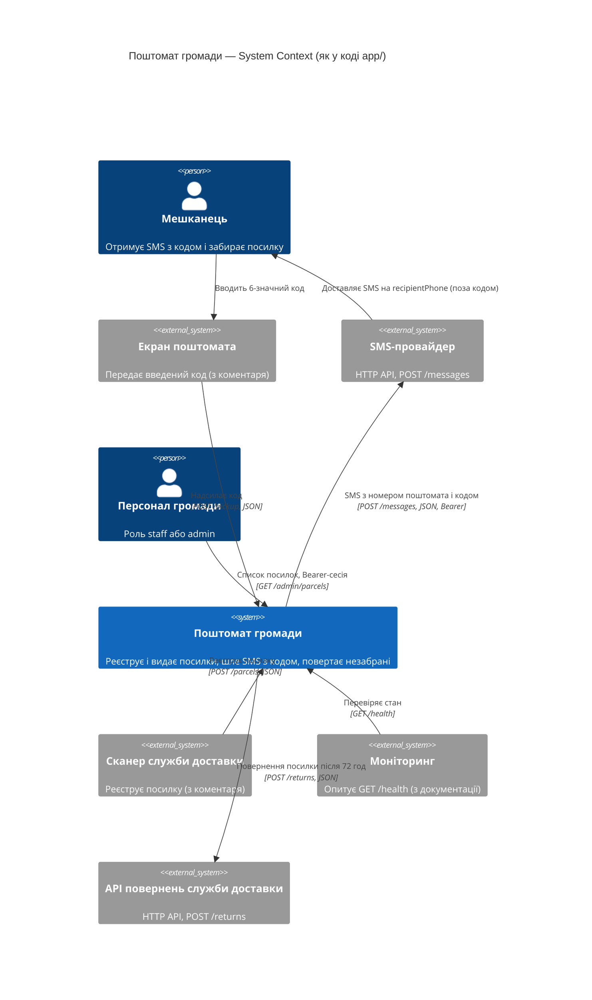
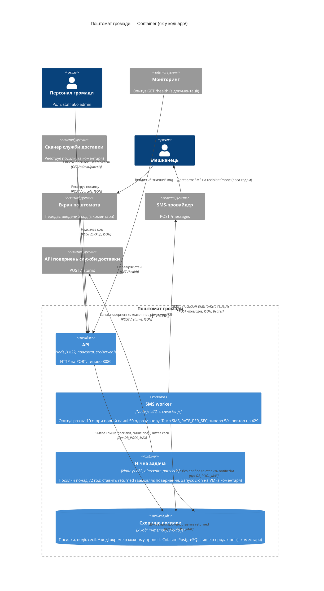
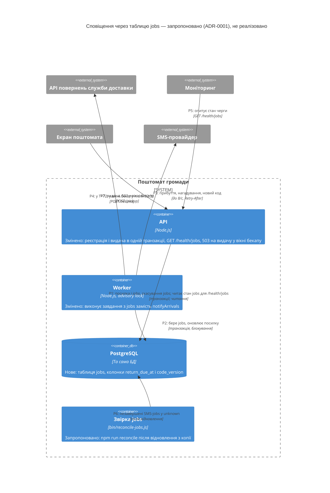

# Архітектура «Поштомата громади» — C4

Діаграми показують систему такою, якою вона є в коді `app/` (v1.7.3, `app/package.json:3`),
а не такою, якою її описує `app/docs/ARCHITECTURE.md` (v1.5). Де код і документація
розходяться, правильним вважаю код. Виняток — спільне сховище: його показано за коментарем
`app/src/db.js:1-2` (див. примітку «Сховище посилок» і правило 5).

## Рівень 1 — System Context

Сканер, екран поштомата і моніторинг показано як зовнішні системи, бо їхнього коду в `app/`
немає. Код містить лише ту частину, що приймає їхні запити. Хто саме викликає
`POST /parcels` і `POST /pickup`, видно тільки з коментарів (`app/src/parcels.js:34`, `:58`),
а хто опитує `GET /health` — тільки з документації (`app/docs/ARCHITECTURE.md:17`).

## Рівень 2 — Container

Mermaid C4 сам ставить усі зовнішні елементи у два стовпці над межею системи, тож лінія
Персонал → API проходить за блоками Сканер, Екран поштомата і API повернень служби доставки,
а лінія Сканер → API — за Екраном поштомата і API повернень. Стрілки — рівно рядки 9–19
таблиці «Стрілки і докази».

Примітки:

- **API.**
  - Усі три процеси — Node.js ≥22 (`app/package.json:14`).
  - API побудовано на `node:http` (`app/src/server.js:1`), слухає `PORT`, типово 8080
    (`app/src/config.js:6`).
- **Сховище посилок.**
  - У коді сховище живе в пам'яті процесу (`app/src/db.js:11-59`).
  - Кожен процес створює власний пул (`app/src/server.js:91`, `app/src/worker.js:43`,
    `app/bin/expire-parcels.js:24`), а разом із ним власне сховище: типовий параметр
    `store = createStore()` (`app/src/db.js:63`).
  - Тож спільне сховище, тобто PostgreSQL у продакшні, існує лише за коментарем
    `app/src/db.js:1-2` (і за `app/README.md:23-24`).
  - `DATABASE_URL` читається (`app/src/config.js:7`), але ніде не використовується: Grep
    `dbUrl` по `app/` дає 1 збіг, і це саме цей рядок.
  - Подій API лише пише (`app/src/parcels.js:67`). `listEvents` (`app/src/db.js:49`) у
    `app/` ніхто не викликає.
- **Сесії персоналу.**
  - Ендпоінту входу немає: Grep `login|/session` по `app/src` дає 0 збігів.
  - API лише шукає сесію за Bearer-токеном (`app/src/server.js:14-19`).
  - `addSession` викликається тільки в тестах (`app/test/server.test.js:63-64`), тож сесії
    створює щось поза `app/`.
- **SMS worker.**
  - Опитує раз на 10 с, але якщо пачка з 50 посилок повна, одразу починає наступний раунд
    (`app/src/worker.js:8-9`, `:65-66`).
  - Темп відправки задає `SMS_RATE_PER_SEC`, типово 5/с (`app/src/config.js:13`).
  - На відповідь 429 повторює запит із паузою (`app/src/sms.js:36-41`).
- **Нічна задача.**
  - Її запускає скрипт `npm run expire` (`app/package.json:11`).
  - Те, що команду викликає cron на VM, видно лише з коментаря `app/bin/expire-parcels.js:2`.
- **Логи.**
  - Усі три процеси пишуть JSON-рядки в stdout (`app/src/log.js:17`; логер створюється в
    `app/src/server.js:90`, `app/src/worker.js:42`, `app/bin/expire-parcels.js:23`).
  - Явно в stderr пише лише нічна задача (`app/bin/expire-parcels.js:32`); необроблені
    помилки інших процесів Node теж виводить у stderr.
  - Хто збирає логи, визначається поза `app/`, тому на діаграмі цього немає.
- **Де код розходиться з `app/docs/ARCHITECTURE.md`:**
  - SMS worker опитує раз на 10 с (`app/src/worker.js:8`), а в документації — раз на 30 с
    (`app/docs/ARCHITECTURE.md:18-19`);
  - код отримання має 6 цифр (`app/src/parcels.js:27`), а в документації — 4
    (`app/docs/ARCHITECTURE.md:18-19`);
  - нічна задача не тільки позначає посилки, а й викликає API повернень
    (`app/bin/expire-parcels.js:15`; у документації — `app/docs/ARCHITECTURE.md:22-23`).

## Стрілки і докази

У стовпцях AI рядки C1 звіряю з System Context відповідного прогону, а рядки C2 — з його
Container. **є** — AI намалював цю взаємодію (у дужках рядок його файлу); **пропустив** — її
немає на діаграмі того самого рівня; **є, але …** — стрілка є, але її підпис суперечить коду.
Стовпець «Стрілка» повторює підпис і технологію `Rel` з діаграми, подробиці винесено в «Доказ».
Підписи, елементи і стрілки, взяті лише з документації чи коментарів, а також припущення AI
без джерела перелічено в наступному розділі.

| # | Стрілка (звідки → куди: що і як) | Доказ (`файл:рядок`) | AI з документації (`ai-runs/c4-from-docs.md`) | AI з коду (`ai-runs/c4-from-code.md`) |
|---|---|---|---|---|
| 1 | C1: Сканер служби доставки → Поштомат громади: реєструє посилку, POST /parcels, JSON | `app/src/server.js:38-41`, `app/src/parcels.js:35-56`. Що викликає саме сканер — лише коментар `app/src/parcels.js:34` | є (:32 — служба доставки як Person, сканер вказано в технології, див. правило 3) | є (:35) |
| 2 | C1: Мешканець → Екран поштомата: вводить 6-значний код | 6 цифр — `app/src/parcels.js:27`, `:60`. Що код вводить людина на екрані — лише коментар `app/src/parcels.js:58`, коду екрана в `app/` немає | є (:33 — екран показано як технологію стрілки, див. правило 3) | є (:33) |
| 3 | C1: Екран поштомата → Поштомат громади: надсилає код, POST /pickup, JSON | `app/src/server.js:42-46`, `app/src/parcels.js:59-68`. Що викликає екран — лише коментар `app/src/parcels.js:58` | є (:33, див. правило 3) | є (:34) |
| 4 | C1: Персонал громади → Поштомат громади: список посилок, Bearer-сесія, GET /admin/parcels | `app/src/server.js:47-50`, `:14-19`, `app/src/parcels.js:15`, `:72-75` | є (:34) | є (:36) |
| 5 | C1: Моніторинг → Поштомат громади: перевіряє стан, GET /health | `app/src/server.js:37` (а `:75` не пише `/health` у журнал доступу). Хто опитує — лише документація `app/docs/ARCHITECTURE.md:17` | є (:37) | є (:37) |
| 6 | C1: Поштомат громади → SMS-провайдер: SMS з номером поштомата і кодом, POST /messages, JSON, Bearer | Запит — `app/src/sms.js:31-35` (JSON і Bearer — `:33-34`). Текст — `app/src/worker.js:11-13`, виклик — `:28` | є (:35) | є (:39) |
| 7 | C1: SMS-провайдер → Мешканець: доставляє SMS на recipientPhone (поза кодом) | Адресат — `app/src/worker.js:28` (`parcel.recipientPhone`), текст — `:12`. Саму доставку робить провайдер, у коді її немає | є, але підпис «з 4-значним кодом» (:36) суперечить коду: код отримання має 6 цифр (`app/src/parcels.js:27`) | є (:40) |
| 8 | C1: Поштомат громади → API повернень служби доставки: повернення посилки після 72 год, POST /returns, JSON | `app/src/courier.js:7-16`, `app/bin/expire-parcels.js:12-15`, `app/src/parcels.js:18`, `:78-81` | пропустив (API повернень на діаграмі немає) | є (:41) |
| 9 | C2: Сканер служби доставки → API: реєструє посилку, POST /parcels, JSON | `app/src/server.js:38-41`, `:93-95`. Сканер як викликач — лише коментар `app/src/parcels.js:34` | є (:68) | є (:67) |
| 10 | C2: Мешканець → Екран поштомата: вводить 6-значний код | Як у рядку 2: `app/src/parcels.js:27`, `:60`; дія людини — лише коментар `:58` | є (:69) | є (:68) |
| 11 | C2: Екран поштомата → API: надсилає код, POST /pickup, JSON | `app/src/server.js:42-46`. Екран як викликач — лише коментар `app/src/parcels.js:58` | є (:70) | є (:69) |
| 12 | C2: Персонал громади → API: список посилок, Bearer-сесія, GET /admin/parcels | `app/src/server.js:47-50`, `:14-19`, `app/src/parcels.js:73-75`. Список без кодів, телефони масковані — `:75` | є (:71) | є (:70) |
| 13 | C2: Моніторинг → API: перевіряє стан, GET /health | `app/src/server.js:37`. Викликач — лише документація `app/docs/ARCHITECTURE.md:17` | є (:72) | є (:71) |
| 14 | C2: API → Сховище: читає і пише посилки, пише події, читає сесії, пул DB_POOL_MAX | Посилки: `app/src/parcels.js:43-55`, `:61`, `:64-66`, `:74`. Події: `app/src/parcels.js:67`. Сесії: `app/src/server.js:18`. Пул: `app/src/server.js:91`, `app/src/config.js:9`. `listEvents` (`app/src/db.js:49`) і `addSession` (`:52`) API не викликає. PostgreSQL — лише коментар `app/src/db.js:1-2` | є, але підпис «Читає/пише посилки, події, сесії» (:74) суперечить коду: подій API не читає (див. «Доказ»), сесій не пише (`addSession` є лише в `app/test/server.test.js:63-64`) | є, але підпис «Читає/пише посилки, події» (:73) суперечить коду: подій API не читає (див. «Доказ») |
| 15 | C2: SMS worker → Сховище: бере без notifiedAt, ставить notifiedAt, пул DB_POOL_MAX | Посилки без `notifiedAt` — `app/src/worker.js:24`, `app/src/db.js:40-45`. Позначка — `app/src/worker.js:33`. Пул — `:43` | є (:75) | є (:74) |
| 16 | C2: Нічна задача → Сховище: шукає прострочені, ставить returned, пул DB_POOL_MAX | `app/bin/expire-parcels.js:12`, `:14`, `app/src/parcels.js:78-88`. Пул — `app/bin/expire-parcels.js:24` | є (:76) | є (:75) |
| 17 | C2: SMS worker → SMS-провайдер: SMS з номером поштомата і кодом, POST /messages, JSON, Bearer | `app/src/worker.js:28`, `:44-49`, `app/src/sms.js:31-35`. Bearer-токен — це `SMS_TOKEN` (`app/src/config.js:12`, `app/src/sms.js:33`) | є (:77) | є (:77) |
| 18 | C2: SMS-провайдер → Мешканець: доставляє SMS на recipientPhone (поза кодом) | Як у рядку 7: `app/src/worker.js:28`, `:12`; доставка поза кодом | є, але підпис «з 4-значним кодом» (:78) суперечить коду: код отримання має 6 цифр (`app/src/parcels.js:27`) | є (:78) |
| 19 | C2: Нічна задача → API повернень служби доставки: запит повернення, reason not_picked_up_72h, POST /returns, JSON | `app/bin/expire-parcels.js:15`, `:26`, `app/src/courier.js:7-16` (`reason` — `:14`) | пропустив (на :62 задача лише «позначає … як повернені») | є (:79) |

## Що AI вигадав / пропустив

Як я вирішував спірні випадки:

1. **Викликач поза кодом.** Моніторинг, сканер і екран — зовнішні викликачі, яких код не може
   ні довести, ні спростувати. Стрілку від них я не вважаю вигаданою, якщо в коді є сторона,
   що приймає запит. Такі стрілки є і на моїх діаграмах (рядки таблиці 1, 3, 5, 9, 11, 13).
2. **Людина → пристрій.** Таку стрілку я малюю, лише якщо код або коментар прямо каже, що
   з пристроєм працює людина.
   - `app/src/parcels.js:58` («the code the person typed») — звідси рядки таблиці 2 і 10.
   - `app/src/parcels.js:34` називає «delivery operator's scanner», тобто організацію, а не
     людину. Тому стрілки «кур'єр-людина → сканер» на моїх діаграмах немає.
   - Стрілка `c4-from-docs.md:67` («служба доставки → сканер») за правилом 5 спирається лише
     на коментар `app/src/parcels.js:34` (служба доставки працює своїм сканером). На моїх
     діаграмах її немає: коментар не називає людину, а служба доставки як організація вже
     представлена елементом «Сканер служби доставки».
3. **Пристрій показано інакше.** Якщо AI показує ту саму взаємодію, але пристрій моделює
   по-іншому (наприклад, екран поштомата — як технологію стрілки «людина → система», а не
   окремий елемент), це **є**. За цим правилом стрілка `c4-from-docs.md:32` (служба доставки
   як Person, сканер — у технології стрілки) покриває рядок 1, а стрілка `c4-from-docs.md:33`
   — рядки 2 і 3.
4. **Неточність у підписі.** Справжня стрілка з атрибутом, який **суперечить коду**
   (неправильне число чи операція, якої в коді немає), — це неточність у підписі, а не вигадана
   стрілка. Підпис «Читає/пише X, Y» я читаю як «читає і пише кожне з X, Y». Якщо читати
   скісну риску як «і/або», рядок 14 не суперечить коду в жодному прогоні: API пише події
   (`app/src/parcels.js:67`) і читає сесії (`app/src/server.js:18`). Тоді в прогоні з коду
   неточностей у підписах 0 (рядок 14 — «є»), а в прогоні з документації — 2 (рядки 7 і 18),
   бо «сесії» в `c4-from-docs.md:74` суперечать коду лише за суворого прочитання (API їх не
   пише). Обидва прочитання — у «Чутливість до правил підрахунку».
5. **Лише з документації чи коментарів.** Якщо підпис, опис, елемент чи стрілку взято
   тільки з документації чи коментарів і код їх ні доводить, ні спростовує, я не рахую це ні
   вигадкою, ні неточністю. Приклади:
   - «SQL» на стрілках до БД (у репозиторії сховище в пам'яті, `app/src/db.js:11-59`,
     PostgreSQL лише в коментарі `:1-2`);
   - docker compose (`app/docs/ARCHITECTURE.md:27`);
   - ContainerDb «PostgreSQL на хості VM, поза контейнерами» / «На VM, поза контейнерами» (`app/docs/ARCHITECTURE.md:20`);
   - Deployment_Node чи межа «Одна VM» (`app/docs/ARCHITECTURE.md:27`);
   - «cron на хості» (`app/bin/expire-parcels.js:2`);
   - стрілка «служба доставки → сканер» (`app/src/parcels.js:34`).

   Кожен такий випадок наведено в клітинці прогону з позначкою «лише з
   документації/коментаря, кодом не підтверджено». Рахую їх за рядками файлу AI.
6. **Припущення AI без джерела.** Атрибут, для якого в `app/` немає джерела і якому код
   не суперечить, перелічую окремо. Це не вигадана стрілка чи компонент і не неточність.
   Рахую за рядками файлу AI.
   - «Linux»: Grep `(?i)linux` по `app/` дає 0 збігів.
   - «HTTPS» на вхідних стрілках до API: API слухає звичайний HTTP (`app/src/server.js:93`),
     README дає `http://localhost:8080` (`app/README.md:20`). TLS може стояти перед API поза
     `app/`, але про це ніде не сказано; прогін з коду сам називає це припущенням
     (`c4-from-code.md:91`).
   - «HTTPS» на вихідних стрілках до SMS-провайдера і API повернень: адреси задають змінні
     оточення (`app/src/config.js:11`, `:14`, типово `http://localhost:…`), а `https://`
     трапляється лише в `app/test/` (напр. `app/test/sms.test.js:26`,
     `app/test/config.test.js:19`, `:21`). У коді сервісу джерела теж немає.

   Так само рахую кожну позначку «HTTPS» в обох прогонах.

| Прогін | Вигадав — стрілки й компоненти, яких у коді немає (і чим це перевірили) | Пропустив — стрілки з таблиці вище, яких немає в AI |
|---|---|---|
| з документації | **Нічого.** C1 (:32-37, 6 стрілок) відповідає рядкам 1–7 (див. правило 3). Із C2 (:67-78, 11 стрілок) 10 відповідають рядкам 9–18, а одинадцята, :67, — під правило 5. Компоненти API, Worker і Нічна задача в коді є. Компонент сховища в коді є (`app/src/db.js:11-59`), тож «PostgreSQL» — лише підпис справжнього компонента (правило 5 стосується підпису), а не вигаданий компонент. Інших інтеграцій немає: Grep `fetch\(` по `app/src` і `app/bin` дає 2 збіги (`app/src/sms.js:31`, `app/src/courier.js:7`), Grep `createServer` — 1 збіг (`app/src/server.js:93`). **Неточності у підписах стрілок (3):** рядки 7 і 18 — «з 4-значним кодом», а код отримання має 6 цифр (`app/src/parcels.js:27`); рядок 14 — API не читає подій і не пише сесій. **Неточність в описі контейнера (1):** Worker «кожні 30 с» (:61), а в коді 10 с (`app/src/worker.js:8`). **Лише з документації/коментаря, кодом не підтверджено (8 рядків):** :58 (Deployment_Node «Одна VM», `app/docs/ARCHITECTURE.md:27`), :60-61 (docker compose: api / worker), :63 (ContainerDb «PostgreSQL на хості VM, поза контейнерами»), :67 (стрілка «служба доставки → сканер», `app/src/parcels.js:34`), :74-76 («SQL»). **Припущення без джерела (3 рядки, правило 6):** :35 і :77 («HTTPS API» до SMS-провайдера), :58 «Linux». | 8, 19 (API повернень служби доставки; документація його не згадує, `app/docs/ARCHITECTURE.md:22-23`) |
| з коду | **Нічого.** C1 (:33-41, 8 стрілок) відповідає рядкам 1–8, C2 (:67-79, 11 стрілок) — рядкам 9–19. Перевірка інтеграцій та сама: `fetch\(` — 2 збіги, `createServer` — 1. **Неточність у підписі стрілки (1):** рядок 14 — «Читає/пише … події» (:73), а API подій не читає (див. рядок 14). Решта розшифровок відповідає коду: 6 цифр (`app/src/parcels.js:27`), 10 с і 50 посилок (`app/src/worker.js:8-9`), `not_picked_up_72h` (`app/src/courier.js:14`), `DB_POOL_MAX` (`app/src/config.js:9`). «ліміт 5 SMS/с» (:62) AI подає як фіксований, але це лише типове значення, яке можна перевизначити змінною оточення (`app/src/config.js:13`: `Number(env.SMS_RATE_PER_SEC) \|\| 5`). Неточністю не рахую, бо типове значення справжнє. **Лише з документації/коментаря, кодом не підтверджено (8 рядків):** :60 (межа «Одна VM»), :61-62 (docker compose: api / worker), :63 («cron на хості VM» — коментар `app/bin/expire-parcels.js:2`), :64 («На VM, поза контейнерами»), :73-75 («SQL»). **Припущення без джерела (7 рядків, правило 6):** «HTTPS» — вхідні :34, :35, :36; вихідні :39, :41, :77, :79. | — |

**Число (Task B):** з документації — **вигадано 0, пропущено 2** (рядки 8 і 19: API повернень
служби доставки); з коду — **вигадано 0, пропущено 0**. Різниця між прогонами — не в стрілках, а в
підписах: 3 неточності з документації (4-значний код, «читає події / пише сесії») і ще 1 в описі
Worker (30 с) проти 1 неточності з коду.

- З документації: 14 «є», 3 «є, але» (рядки 7, 14, 18), 2 «пропустив»; лише з документації чи
  коментаря — 8 рядків; припущення без джерела — 3 (:35, :77 «HTTPS», :58 «Linux»).
- З коду: 18 «є», 1 «є, але» (рядок 14), 0 «пропустив»; лише з документації чи коментаря —
  8 рядків; припущення без джерела — 7 («HTTPS»: :34, :35, :36, :39, :41, :77, :79).

**Чутливість до правил підрахунку.** Без правил 3 і 5, тобто за буквальним прочитанням шаблону,
прогін з документації дає «вигадано 1, пропущено 5»: стрілка :67 «служба доставки → сканер» і
рядки 1–3, бо :32 і :33 не мають окремого елемента сканера чи екрана. Прогін з коду не
змінюється: екран і сканер там окремі елементи. Якщо «Читає/пише» читати як «і/або» (правило 4),
неточностей у підписах 2 з документації (рядки 7, 18) і 0 з коду. ContainerDb «PostgreSQL» і межу
«Одна VM» вигаданими не рахую за жодного прочитання: це справжній компонент і групування
розгортання. Висновок від правил не залежить: з коду AI не помилився в жодній стрілці, а з
документації пропустив API повернень, про яке документація мовчить (`app/docs/ARCHITECTURE.md:22-23`).

## Запропоноване (з ADR) — необов'язково

Діаграма нижче показує лише те, що рішення ADR-0001 (`docs/adr/0001-notifications.md`,
статус «запропоновано») додає або змінює порівняно з поточними контейнерами. У коді цього
ще немає, тому ці стрілки не входять ні в таблицю вище, ні в підрахунки AI. Нічна задача зникає,
повернення бере на себе Worker (розділ «Таймер повернення», рядок 155 ADR; «Що треба
зробити», рядок 276 ADR).

| Стрілка / елемент | Розділ ADR (`docs/adr/0001-notifications.md`) |
|---|---|
| P1 API → PostgreSQL: посилка і jobs, скасування jobs; читає стан jobs для /health/jobs, транзакції; читання | «Рішення», рядки 95–100 (посилка і 4 завдання в одній транзакції); «Таблиця `jobs`», рядки 132–137 (атомарне створення) і 140 (скасування при видачі); «Таймер повернення», рядок 147. Спирається на припущення П1 (рядок 45). Читання стану jobs для /health/jobs — «Черга і темп відправки», рядок 179 |
| P2 Worker → PostgreSQL: бере jobs, оновлює посилку, транзакція, блокування | «Рішення», рядок 102; «Перевірка статусу при спрацюванні», рядок 159; «Черга і темп відправки», рядки 170–171; «Таймер повернення», рядок 150 (ставить посилці `returned`, скасовує SMS-завдання); «Стан `unknown`», рядки 191–195 (новий код, `code_version`, завдання `code_reissue_sms`) |
| P3 Worker → SMS-провайдер: прибуття, нагадування, новий код, до 8/с, Retry-After | «Рішення», рядки 97–99; «Черга і темп відправки», рядки 166–169; «Тихі години», рядок 208; «Стан `unknown`», рядки 191–195 (перевипуск коду) |
| P4 Worker → API повернень: у T+72, у вікні бекапу після 02:30, POST /returns | «Рішення», рядок 108; «Таймер повернення», рядки 149–155; «Вікно бекапу», рядок 221 |
| P5 Моніторинг → API: опитує стан черги, GET /health/jobs | «Черга і темп відправки», рядки 179–185. Спирається на припущення П2 (рядок 46) |
| P6 Звірка jobs → PostgreSQL: незавершені SMS-jobs у unknown, після відновлення | «Стан `unknown`», рядки 199–202; «Що треба зробити», рядок 276 |
| P7 Екран поштомата → API: видача, 503 у вікні бекапу, POST /pickup | «Вікно бекапу», рядок 222. Спирається на припущення П4 (рядок 48) |
| Елемент PostgreSQL: таблиця jobs, колонки return_due_at і code_version | «Таблиця `jobs`», рядки 121–130 |
| Елемент API: 503 на видачу у вікні бекапу (опис контейнера) | «Вікно бекапу», рядок 222; «Що треба зробити», рядок 275 |
| Елемент API: реєстрація і видача в одній транзакції (опис контейнера) | «Рішення», рядок 95; «Таймер повернення», рядок 147 |
| Елемент Worker: advisory lock (технологія контейнера) | «Черга і темп відправки», рядок 170; «Що треба зробити», рядок 264 |
| Елемент Worker: виконує завдання з jobs замість notifyArrivals (опис контейнера) | «Що треба зробити», рядок 263 |
| Елемент Звірка jobs: bin/reconcile-jobs.js, npm run reconcile після відновлення з копії | «Стан `unknown`», рядок 201; «Що треба зробити», рядок 276 |
