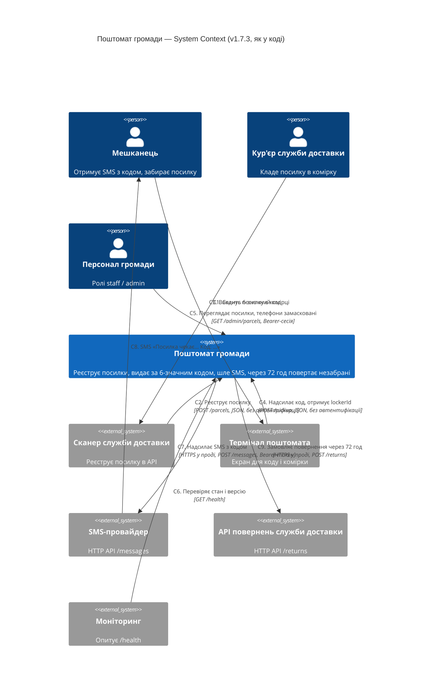
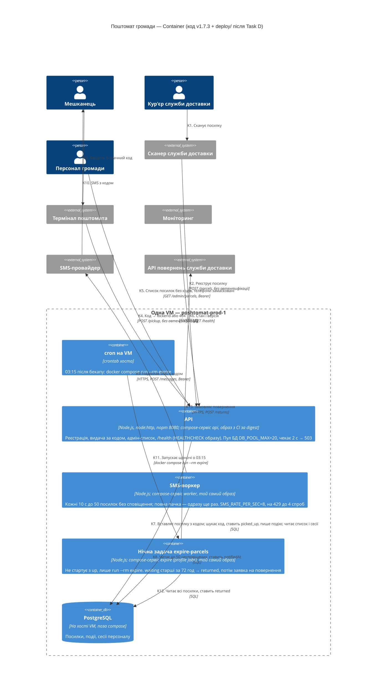

# Архітектура «Поштомата громади» — C4

> Task B. Діаграми показують систему **такою, якою вона є в коді v1.7.3** (`app/package.json:3`),
> а не такою, як її описує `app/docs/ARCHITECTURE.md` (v1.5). Кожна стрілка — рядок таблиці
> нижче з доказом `файл:рядок`. Перші відповіді AI — `ai-runs/c4-from-docs.md`
> (лише документація) і `ai-runs/c4-from-code.md` (уся `app/`).
>
> Рівень Container показує розгортання **після Task D**:
> - `deploy/compose.yaml` бере образ з CI за digest (`POSHTOMAT_IMAGE`);
> - нічна задача — окремий сервіс `expire`, який cron запускає через `run --rm expire`.
>
> До Task D задачу запускали як `run --rm worker npm run expire` (`docs/ops/backup-runbook.md:18-19`).
> Після деплою нового compose запис у crontab на VM треба змінити.
>
> Оцінки прогонів AI від цього не змінюються: жоден прогін `deploy/` не бачив (прогін з коду —
> «без … `deploy/`», `ai-runs/c4-from-code.md:3`; прогін з документації — лише два файли,
> `ai-runs/c4-from-docs.md:3`), тож Task D не змінює того, що вони могли знати. Рахуємо їх
> проти того, що діяло в проді на момент прогонів (пул 20, SMS 20/с). Після прогонів
> `SMS_RATE_PER_SEC` змінено з 20 на 8 (ADR, Р3); підпис K9 «5 SMS/с» хибний і так, і так.

## Рівень 1 — System Context

## Рівень 2 — Container

Чого на діаграмах **немає**, бо цього немає в коді:

- **API → SMS-провайдер.** `deploy/compose.yaml:23-25` (спільний блок `x-env`, у `api` — через
  `:57`) дає сервісу `api` змінні `SMS_*`, але
  API їх не використовує. `grep -rn createSmsClient app/src app/bin` знаходить лише
  `app/src/worker.js:5` і `:44`.
- **Ендпоінта входу для персоналу.** Сесії тільки читаються (`app/src/server.js:14-19`).
  `addSession` визначено в `app/src/db.js:52`, але з `src/` і `bin/` його ніхто не викликає.
  Хто створює сесії, з коду не видно.
- **TLS на вході.** API — це `http.createServer` (`app/src/server.js:93`), і compose публікує
  `8080:8080` без проксі (`deploy/compose.yaml:54-55`). HTTPS є лише на вихідних викликах
  (`deploy/compose.yaml:23`, `:26`).

## Стрілки і докази

«AI мав рацію?»: **є** — AI намалював цю стрілку (у дужках — що в підписі неправильно);
**пропустив** — у його діаграмі цієї стрілки немає. Шляхи — від кореня репозиторію.

### System Context

| # | Стрілка (звідки → куди: що і як) | Доказ (`файл:рядок`) | AI з документації (`ai-runs/c4-from-docs.md`) | AI з коду (`ai-runs/c4-from-code.md`) |
|---|---|---|---|---|
| C1 | Кур'єр → Сканер: сканує посилку, коли кладе її в комірку | `app/src/parcels.js:34` («Called by the delivery operator's scanner when a parcel goes into a cell») | є | є |
| C2 | Сканер → Поштомат: `POST /parcels` `{lockerId, recipientPhone, sender}`, без автентифікації | `app/src/server.js:38-40`; `app/src/parcels.js:35-55` | є (вигаданий HTTPS) | є |
| C3 | Мешканець → Термінал: вводить 6-значний код | `app/src/parcels.js:58`, `:60` (`/^\d{6}$/`), `:27` (`padStart(6, "0")`) | є (**«4-значний код»** — у коді 6 цифр) | є |
| C4 | Термінал → Поштомат: `POST /pickup {code}` → `{id, lockerId}` або 404, без автентифікації | `app/src/server.js:42-45`; `app/src/parcels.js:58-68` | є (вигаданий HTTPS) | є |
| C5 | Персонал → Поштомат: `GET /admin/parcels`, `Authorization: Bearer <сесія>`, ролі staff/admin, без кодів, телефони замасковані | `app/src/server.js:13-19`, `:47-49`; `app/src/parcels.js:15`, `:71-75` | є (вигаданий HTTPS) | є |
| C6 | Моніторинг → Поштомат: `GET /health` → `{status, version}`, у лог не пишеться | `app/src/server.js:37`, `:75` | є | є |
| C7 | Поштомат → SMS-провайдер: `POST {SMS_BASE_URL}/messages`, Bearer-токен, `{to, text}`; у проді HTTPS | `app/src/sms.js:31-35`; `deploy/compose.yaml:23-24` | є | є |
| C8 | SMS-провайдер → Мешканець: «Посилка чекає у поштоматі №… Код: …» на `recipientPhone` | `app/src/worker.js:11-13`, `:28` | є | є |
| C9 | Поштомат → API повернень: `POST {COURIER_BASE_URL}/returns`, `reason: not_picked_up_72h` | `app/src/courier.js:7-15`; `app/bin/expire-parcels.js:15`; `deploy/compose.yaml:26` | **пропустив** — у документації цієї системи немає | є |

### Container

| # | Стрілка (звідки → куди: що і як) | Доказ (`файл:рядок`) | AI з документації (`ai-runs/c4-from-docs.md`) | AI з коду (`ai-runs/c4-from-code.md`) |
|---|---|---|---|---|
| K1 | Кур'єр → Сканер | `app/src/parcels.js:34` | **пропустив** — кур'єра немає на рівні Container | є |
| K2 | Сканер → API: `POST /parcels` | `app/src/server.js:38-40` | є (вигаданий HTTPS) | є |
| K3 | Мешканець → Термінал: вводить код | `app/src/parcels.js:58`, `:60` | **пропустив** | є |
| K4 | Термінал → API: `POST /pickup` → `lockerId` / 404 | `app/src/server.js:42-45`; `app/src/parcels.js:68` | є (вигаданий HTTPS) | є |
| K5 | Персонал → API: `GET /admin/parcels`, Bearer | `app/src/server.js:47-49`; `app/src/parcels.js:71-75` | є (**«браузер»** — веб-інтерфейсу в коді немає, вигаданий HTTPS) | є |
| K6 | Моніторинг → API: `GET /health` | `app/src/server.js:37` | є | є |
| K7 | API → PostgreSQL: вставка посилки з новим кодом; пошук за кодом, `picked_up`, подія; список; сесії | `app/src/parcels.js:43-55`, `:61`, `:64-67`, `:74`; `app/src/server.js:18`; PostgreSQL — `app/src/db.js:1-2`, `deploy/compose.yaml:1`, `:8`, `:20` | є | є (пул «до 4» — у проді `DB_POOL_MAX: "20"`, `deploy/compose.yaml:21`) |
| K8 | Воркер → PostgreSQL: `listUnnotified(50)`, потім `notifiedAt` | `app/src/worker.js:9`, `:24`, `:33` | є (**«кожні 30 с»** — у коді 10 с, `app/src/worker.js:8`) | є |
| K9 | Воркер → SMS-провайдер: `POST /messages`, темп `SMS_RATE_PER_SEC`, на 429 повтор | `app/src/worker.js:28`, `:44-49`; `app/src/sms.js:21-25`, `:31-41`; `deploy/compose.yaml:25` | є | є (**«не більше 5 SMS/с»** — це лише значення за замовчуванням, `app/src/config.js:13`; у проді 20, з 26.10 — 8, `deploy/compose.yaml:25`) |
| K10 | SMS-провайдер → Мешканець: SMS з кодом | `app/src/worker.js:12`, `:28` | є | є |
| K11 | cron на VM → Нічна задача: о 03:15, `docker compose run --rm expire` (до Task D — `run --rm worker npm run expire`) | `deploy/compose.yaml:15`, `:81-87` (сервіс `expire`, `profiles: [jobs]`, `command: node bin/expire-parcels.js`); `app/bin/expire-parcels.js:2`; час 03:15 — `docs/ops/backup-runbook.md:18-19` | **пропустив** — cron є лише в тексті припущень | **пропустив** — cron є лише в підписі контейнера й у припущеннях |
| K12 | Нічна задача → PostgreSQL: читає всі посилки, фільтрує `waiting` і понад 72 год, ставить `returned` | `app/src/parcels.js:18`, `:78-87`; `app/bin/expire-parcels.js:12`, `:14` | є (підпис **неповний**: лише «оновлює статус», без читання; хибним не рахую — сказане правильне) | є |
| K13 | Нічна задача → API повернень: `POST /returns` після `markReturned` | `app/bin/expire-parcels.js:14-15`; `app/src/courier.js:7` | **пропустив** | є |

## Що AI вигадав / пропустив

Окремо рахую **стрілки й компоненти, яких у коді немає**, і **хибні підписи** на стрілках та
контейнерах, які в коді є. Хибний підпис — той, що каже неправду (4 цифри замість 6).
Неповний підпис, у якому все сказане правильне (K12 у прогоні з документації), до хибних не
рахую — він позначений у таблиці вище.

| Прогін | Вигадав — стрілки й компоненти, яких у коді немає (і чим це перевірили) | Хибні підписи на правильних стрілках | Пропустив — стрілки з таблиці вище, яких немає в AI |
|---|---|---|---|
| з документації | Стрілок і компонентів — **0**. Усі 8 стрілок Context і 9 стрілок Container є в коді. | 1) «4-значний код» — у коді 6 цифр (`app/src/parcels.js:27`, `:60`). 2) «Кожні 30 с» — у коді 10 с (`app/src/worker.js:8`). 3) HTTPS на вхідних стрілках — API на `node:http` (`app/src/server.js:93`), порт 8080 без проксі (`deploy/compose.yaml:55`). 4) Персонал заходить «через браузер» — UI і входу немає (`app/src/server.js:36-51`: чотири маршрути, усі JSON). | **5**: C9, K1, K3, K11, K13. Головне — уся зовнішня система «API повернень»: документація про неї мовчить (`app/docs/ARCHITECTURE.md:22-23`). |
| з коду | Стрілок і компонентів — **0**. Усі 9 стрілок Context і 12 стрілок Container є в коді. | 1) «Не більше 5 SMS/с» — у проді 20 (`deploy/compose.yaml:25`). 2) «Пул до 4 з'єднань, разом до 12» — у проді `DB_POOL_MAX: "20"` на процес (`deploy/compose.yaml:21`; спільний `x-env` для api, worker і expire — `:57`, `:70`, `:88`), тобто до 60. 3) Посилання на `parcels.js:28` для 6-значного коду — код генерується на `:27`. Перші дві помилки — від того, що сесія не бачила `deploy/`. | **1**: K11 (запуск cron). |

**Разом:** з документації — вигадано 0 стрілок (і 4 хибні підписи), пропущено 5; з коду —
вигадано 0 стрілок (і 3 хибні підписи), пропущено 1.

**Висновок.** Документація не вигадала зайвих стрілок, але **застаріла**. Вона пропускає
цілу зовнішню систему (повернення) і дає неправильні числа (4 цифри, 30 с), які AI
переніс на діаграму без перевірки. Прогін з коду знайшов усі стрілки, крім запуску
нічної задачі з cron (K11: cron є лише в тексті, без стрілки), і сам указав на розбіжності
з документацією. Але він не бачив `deploy/`, тому взяв значення за
замовчуванням з `config.js` (5 SMS/с, пул 4), а в проді діяли інші (20 і 20; з 26.10 SMS — 8). Отже,
джерело правди для діаграми — код **разом із** конфігурацією розгортання.

## Запропоноване (з ADR)

На діаграмах вище — лише те, що є в коді зараз. Зміни з
`docs/adr/0001-notifications.md` (статус «запропоновано») сюди **не** внесені:

- таблиця `parcel_jobs` — розділ «Р1. Таблиця завдань»;
- темп SMS 8/с — розділ «Р3» (`SMS_RATE_PER_SEC` 20 → 8 уже зроблено 26.10, тож на діаграмі вище стоїть 8);
- нічний cron о 03:15 прибирається — розділ «Р7».

Коли ADR приймуть, ці зміни треба позначити на діаграмах як «запропоновано».
