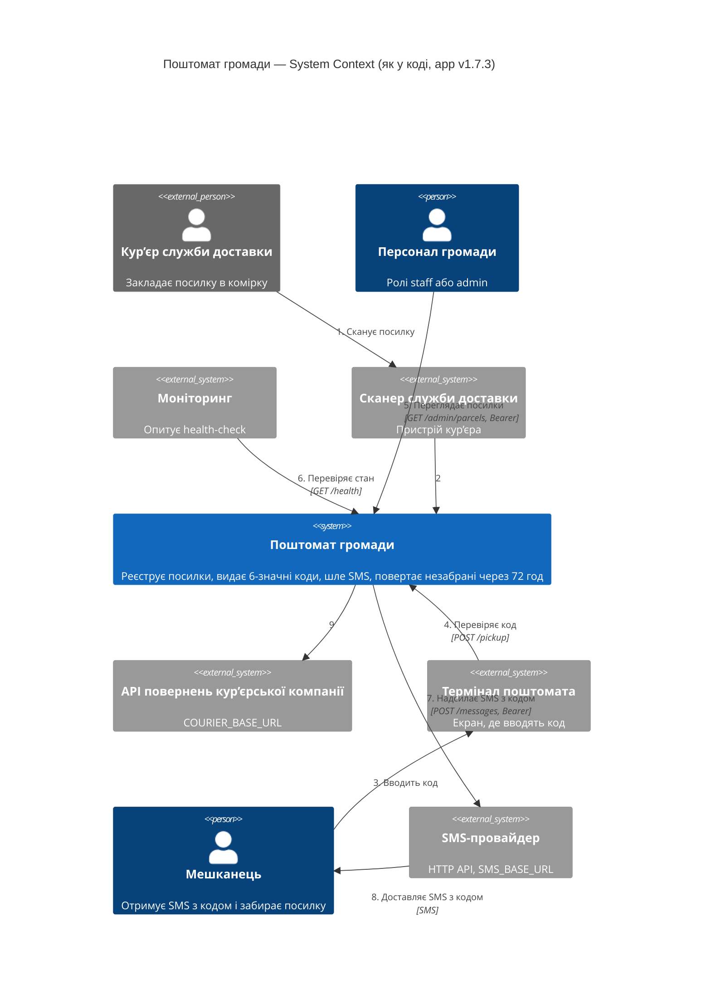
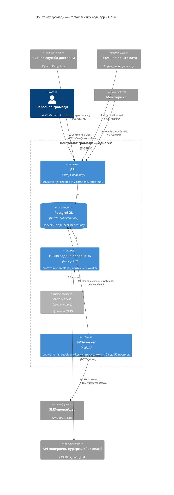
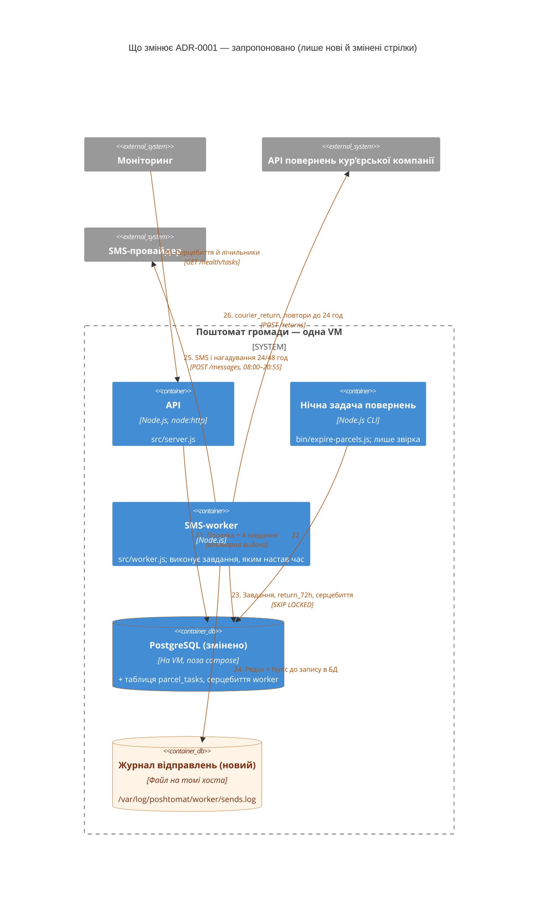

# Архітектура «Поштомата громади» — C4

## Коротко

- **Що на діаграмах.** Система такою, якою вона є в коді: `app/` v1.7.3 (`app/package.json:3`).
  Те, чого з `app/` не видно (розгортання, cron, PostgreSQL), підтверджено
  `deploy/compose.yaml` і `docs/ops/backup-runbook.md`. Якщо факт є лише в документації або
  це висновок, так і написано в рядку таблиці.
- **Як читати.** Номер на стрілці — це номер рядка таблиці: 1–19 — у «Стрілки і докази»,
  20–26 — у «Запропоноване (з ADR)». Короткі стрілки (2, 9, 14, 18, 22) підписані лише
  номером, опис — у таблиці.
- **Вузький екран.** На телефоні чи планшеті Mermaid C4 ставить блоки в 1–2 колонки, і
  підписи налазять на блоки. Під кожною діаграмою є PNG з розкладкою для широкого екрана.
- **Результат порівняння з AI** (база — 19 стрілок наших діаграм): AI з документації вигадав 0
  і пропустив 3 — виклик API повернень (рядки 9 і 19) і cron (рядок 17); AI з коду вигадав 0
  і пропустив 0.
- **Рядки `deploy/compose.yaml`** наведено за станом коміту `c6800ab`, тобто до змін Task D.

## Рівень 1 — System Context

PNG тієї самої діаграми: [`architecture-context.png`](architecture-context.png).

## Рівень 2 — Container

Кур’єра й мешканця тут немає: їхні стрілки (1, 3, 8) не торкаються контейнерів і вже є на
рівні 1.

PNG тієї самої діаграми: [`architecture-container.png`](architecture-container.png).

**Головне:** API, SMS-worker і нічна задача напряму між собою не спілкуються, їх пов’язує
лише база. Кожен процес створює власний пул з’єднань (`app/src/server.js:91`,
`app/src/worker.js:43`, `app/bin/expire-parcels.js:24`).

## Стрілки і докази

Один рядок — одна стрілка з діаграм вище. Колонки AI відповідають на питання «AI мав
рацію?»: **є** — AI намалював цю стрілку (у дужках — рядок його відповіді в `ai-runs/`; два
номери — якщо він намалював її на обох рівнях); **пропустив** — у його діаграмах її немає.

### Рівень 1 — System Context

| # | Стрілка (звідки → куди: що і як) | Доказ (`файл:рядок`) | AI з документації (`ai-runs/c4-from-docs.md`) | AI з коду (`ai-runs/c4-from-code.md`) |
|---|---|---|---|---|
| 1 | Кур’єр → Сканер: сканує посилку, коли кладе її в комірку | `app/src/parcels.js:34` (сканер, комірка); кур’єр як особа — висновок, ні в коді, ні в документах його немає | є (`:51`, `:86`) | є (`:44`, `:102`) |
| 2 | Сканер → Поштомат громади: реєструє посилку, `POST /parcels`, без автентифікації | `app/src/server.js:38-40`, `app/src/parcels.js:34-35` | є (`:52`) | є (`:45`) |
| 3 | Мешканець → Термінал: вводить 6-значний код | `app/src/parcels.js:58`, `:60` | є (`:53`, `:88`) | є (`:48`, `:103`) |
| 4 | Термінал → Поштомат громади: перевіряє код, `POST /pickup` → `{id, lockerId}` | `app/src/server.js:42-45`, `app/src/parcels.js:58-68` | є (`:54`) | є (`:49`) |
| 5 | Персонал → Поштомат громади: список посилок, `GET /admin/parcels`, Bearer-сесія, ролі staff/admin | сесія — `app/src/server.js:13-19`; маршрут — `:47-49`; ролі — `app/src/parcels.js:15`, `:71-76` | є (`:55`) | є (`:50`) |
| 6 | Моніторинг → Поштомат громади: `GET /health` | ендпоінт — `app/src/server.js:37`; хто опитує — лише `app/docs/ARCHITECTURE.md:17` | є (`:56`) | є (`:52`) |
| 7 | Поштомат громади → SMS-провайдер: SMS з кодом, `POST {SMS_BASE_URL}/messages`, Bearer | запит — `app/src/sms.js:31-35`; виклик — `app/src/worker.js:28`, `:44-49` | є (`:57`) | є (`:46`) |
| 8 | SMS-провайдер → Мешканець: «Посилка чекає у поштоматі №… Код: …» | `app/src/worker.js:11-13`, `:28` | є (`:58`, `:98`) | є (`:47`, `:111`) |
| 9 | Поштомат громади → API повернень кур’єрської компанії: заявка на повернення, `POST {COURIER_BASE_URL}/returns` | запит — `app/src/courier.js:6-19`; виклик — `app/bin/expire-parcels.js:15`, `:26` | пропустив: вважав, що нічна задача «тільки змінює статус» (`:30`) | є (`:51`) |

### Рівень 2 — Container

| # | Стрілка (звідки → куди: що і як) | Доказ (`файл:рядок`) | AI з документації (`ai-runs/c4-from-docs.md`) | AI з коду (`ai-runs/c4-from-code.md`) |
|---|---|---|---|---|
| 10 | Сканер → API: `POST /parcels`, без автентифікації | `app/src/server.js:38-40` | є (`:87`) | є (`:101`) |
| 11 | Термінал → API: `POST /pickup` → `{id, lockerId}` | `app/src/server.js:42-45`, `app/src/parcels.js:68` | є (`:89`) | є (`:104`) |
| 12 | Персонал → API: `GET /admin/parcels`, Bearer; без кодів, телефони масковані | `app/src/server.js:13-19`, `:47-49`; `app/src/parcels.js:71-76` | є (`:90`) | є (`:105`) |
| 13 | Моніторинг → API: `GET /health`, без звернення до БД | ендпоінт — `app/src/server.js:37`; хто опитує — `app/docs/ARCHITECTURE.md:17` | є (`:91`) | є (`:106`) |
| 14 | API → PostgreSQL: вставляє й оновлює посилки, пише події, шукає сесії; пул `DB_POOL_MAX`, 503 після `DB_POOL_WAIT_MS` | посилки й події — `app/src/parcels.js:43-44`, `:61-67`, `:74`; сесії — `app/src/server.js:18`; пул і 503 — `app/src/server.js:65`, `:91`, `app/src/config.js:9-10`; PostgreSQL — `deploy/compose.yaml:2`, `:15` | є (`:93`) | є (`:108`) |
| 15 | SMS-worker → PostgreSQL: бере до 50 неповідомлених, ставить `notifiedAt` | `app/src/worker.js:9`, `:24`, `:33` | є (`:94`) | є (`:109`) |
| 16 | SMS-worker → SMS-провайдер: `POST /messages`, Bearer `SMS_TOKEN`, не більше `SMS_RATE_PER_SEC`, повтор на 429 | темп і повтор — `app/src/sms.js:21-41`; виклик — `app/src/worker.js:28`, `:44-49` | є (`:97`) | є (`:110`) |
| 17 | cron → Нічна задача: щоночі о 03:15, `docker compose run --rm worker npm run expire` | `docs/ops/backup-runbook.md:18-19`; `app/bin/expire-parcels.js:2`; `app/package.json:11` | пропустив: cron є лише в тексті припущення 4 (`:27`), стрілки на діаграмі немає | є (`:112`) |
| 18 | Нічна задача → PostgreSQL: шукає `waiting` старші за 72 год, ставить `returned` | `app/src/parcels.js:78-87`; `app/bin/expire-parcels.js:12-14` | є (`:95`) | є (`:113`) |
| 19 | Нічна задача → API повернень кур’єрської компанії: `POST /returns`, без автентифікації | запит — `app/src/courier.js:6-19`; виклик — `app/bin/expire-parcels.js:15`, `:26` | пропустив (той самий виклик, що й 9) | є (`:114`) |

## Що AI вигадав / пропустив

| Прогін | Вигадав — стрілки й компоненти, яких у коді немає (і чим це перевірили) | Пропустив — стрілки з таблиці вище, яких немає в AI |
|---|---|---|
| з документації | **Нічого.** Стрілки: усі 19 стрілок відповіді (8 на рівні 1, 11 на рівні 2) стоять у колонці «AI з документації» вище. Компоненти: кожен має відповідник на наших діаграмах; його «Поштомат» (`:47`) — наш «Термінал поштомата», PostgreSQL — `deploy/compose.yaml:2`. | **3:** 9 (Поштомат громади → API повернень), 17 (cron → нічна задача), 19 (нічна задача → API повернень) |
| з коду | **Нічого.** Стрілки: усі 22 стрілки відповіді (9 на рівні 1, 13 на рівні 2) стоять у колонці «AI з коду» вище. Компоненти: кожен має відповідник; його «Екран поштомата» (`:38`) — наш «Термінал поштомата», `cron` (`:85`) — наш «cron на VM». Невидимі `Boundary` (`:91-92`) потрібні лише для розкладки. | **0** |

**Разом** (база — 19 стрілок наших діаграм, рядки 1–19): з документації — вигадано 0,
пропущено 3 з 19 (рівень 1: 1 з 9; рівень 2: 2 з 10). По суті це два пропущені факти: виклик
API повернень (рядки 9 і 19 — той самий виклик на двох рівнях) і cron (рядок 17). З коду —
вигадано 0, пропущено 0 з 19.

### Неточності в описах (у підсумок не входять)

Стрілка чи елемент у AI є, але деталь в описі не збігається з кодом:

- **з документації:** worker «кожні 30 с» (опис елемента `c4-from-docs.md:78`, підпис стрілки
  `:94`), а в коді — 10 с, і якщо пачка з 50 повна, наступна йде одразу
  (`app/src/worker.js:8`, `:65-66`). Код «4-значний» (`:78`), а в коді — 6 цифр
  (`app/src/parcels.js:27`, `:60`). Обидві помилки взято із застарілого
  `app/docs/ARCHITECTURE.md:18-19` (v1.5).
- **з коду:** неточностей немає. «Пул до 4 з’єднань» і «до 5 SMS/с» (`c4-from-code.md:108`,
  `:110`) збігаються з типовими значеннями в коді (`app/src/config.js:9`, `:13`). У продакшні
  compose ставить 20 і 20 (`deploy/compose.yaml:16`, `:20`), але `deploy/` цьому прогону не
  показували.

## Чого на діаграмах немає і чому

- **Драйвера PostgreSQL у репо немає.** Сховище — у пам’яті (`app/src/db.js:1-2`).
  `DATABASE_URL` читається (`app/src/config.js:7`), але `createPool` його не отримує
  (`app/src/server.js:91`, `app/src/worker.js:43`, `app/bin/expire-parcels.js:24`).
  PostgreSQL на діаграмі взято з `deploy/compose.yaml:2`, `:15` і `app/README.md:23-24`;
  продакшн-адаптер живе поза репо.
- **API не викликає ні SMS-провайдера, ні API повернень**, хоча compose передає йому
  `SMS_TOKEN` і `COURIER_BASE_URL` (`deploy/compose.yaml:18-21`): `app/src/server.js:1-7`
  не імпортує ні `sms.js`, ні `courier.js`. Тому стрілок від API до них немає.
- **Входу для персоналу немає.** Сесії лише читаються (`app/src/server.js:18`), а
  створюються тільки в тестах (`app/test/server.test.js:63-64`). Хто видає сесії, з коду не
  видно.
- **Хто відчиняє комірку, з коду не видно.** API лише повертає `{id, lockerId}`
  (`app/src/parcels.js:68`).
- **Логи** — JSON у stdout (`app/src/log.js:17`); куди вони йдуть далі, з коду не видно.
- **Служба доставки і кур’єрська компанія** намальовані окремо. Код називає їх по-різному
  (`app/src/parcels.js:34` — сканер служби доставки, `app/src/courier.js:1` — API кур’єрської
  компанії), а чи це одна організація, невідомо.

## Запропоноване (з ADR)

Ця діаграма окрема, щоб не змішувати запропоноване з тим, що є в коді. Усе на ній взято з
`docs/adr/0001-notifications.md` (статус «запропоновано», `:3`). Помаранчеві стрілки — нові
або змінені; помаранчевий фон — новий елемент, помаранчева рамка — змінений. Незмінені
стрілки (10–13, 17) не показано: вони такі самі, як на рівні 2. До порівняння з AI ці стрілки
не входять («н/з» — не застосовно).

PNG тієї самої діаграми: [`architecture-proposed.png`](architecture-proposed.png).

| # | Стрілка (запропоновано) | Було на рівні 2 | Доказ — розділ ADR (`docs/adr/0001-notifications.md`) | AI з документації | AI з коду |
|---|---|---|---|---|---|
| 20 | Моніторинг → API: `GET /health/tasks` — серцебиття й лічильники, без номерів і кодів | нова | Р7 «Серцебиття» (`:343-346`); хто опитує — `:356` | н/з | н/з |
| 21 | API → PostgreSQL: `POST /parcels` — посилка й 4 завдання в одній транзакції; `POST /pickup` — один `UPDATE`, завдання посилки → `cancelled` | змінює 14 | Р2 (`:176-185`) | н/з | н/з |
| 22 | Нічна задача → PostgreSQL: лише звірка, нічого не надсилає | змінює 18 | Р6 (`:310-316`) | н/з | н/з |
| 23 | SMS-worker → PostgreSQL: бере завдання (`FOR UPDATE SKIP LOCKED`), виконує `return_72h`, пише серцебиття | змінює 15 | Р1 (`:145-172`), Р3 (`:186-205`), Р6 (`:296-300`), Р7 (`:343`) | н/з | н/з |
| 24 | SMS-worker → Журнал відправлень: рядок і `fsync`, перш ніж записати результат у БД | нова | Р7 «Журнал відправлень» (`:322-331`) | н/з | н/з |
| 25 | SMS-worker → SMS-провайдер: SMS про прибуття й нагадування через 24 і 48 год, лише 08:00–20:55 | змінює 16 | Р2 (`:176-178`), Р4 (`:236-241`) | н/з | н/з |
| 26 | SMS-worker → API повернень кур’єрської компанії: `courier_return` з повторами до 24 год | замінює 19 | Р6 (`:305-307`) | н/з | н/з |

Стрілка 19 (Нічна задача → API повернень кур’єрської компанії) зникає: заявку на повернення
надсилає SMS-worker як завдання `courier_return` (стрілка 26; Р6, `:305-316`).
