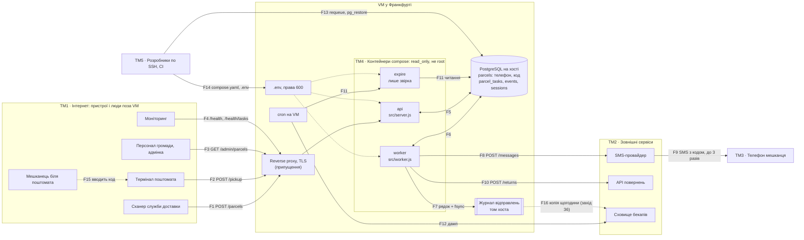

# Task E (bonus) — шлях 2: STRIDE для архітектури з ADR-0001

- **Що моделюємо:** «Поштомат громади» після `docs/adr/0001-notifications.md` (статус
  «запропоновано»), з деплоєм після Task D (`deploy/compose.yaml`, `pipeline/deploy.yml`).
- **Як:** за чотирма питаннями Адама Шостака — розділи 1, 2–3 і 4.
- **Автор:** FeschenkoNatalia; чернетка — Claude Code (Claude Opus 5.5, `claude-opus-5-5`).
  Кожна загроза спирається на код, ADR чи матеріали (`файл:рядок`); припущення названо прямо.
- **Дата:** 2026-11-03.

## Коротко

STRIDE, а не оцінка вартості: вартість ADR уже порахував — нових ІТ-витрат немає, змінна лише
плата за SMS. Найбільший фінансовий ризик рішення — не тариф, а зловживання, і ADR його не
розглядає.

**Висновок.** Безпека рішення не спростовує, але без кількох заходів робить систему дешевшою
для зловживань і крихкішою (З1–З20 — номери загроз у таблиці розділу 2–3):

- **Фальшиві посилки (З1).** Зареєструвати посилку може будь-хто, без ключа. Після ADR кожна
  фальшива посилка — до трьох SMS замість одного: посилка на хвилину за вихідні ≈ 397 €.
- **Чужа видача (З2).** Перебір 6-значних кодів дає ~18 «видач» чужих посилок на годину: код
  мешканця перестає діяти, посилка лишається в комірці без повернення, а після ADR — ще й без
  нагадувань.
- **Деплой під час відновлення (З4).** Pipeline переписує конфігурацію на сервері й знімає
  утримання, яке ставлять на час відновлення з копії: SMS підуть удруге.
- **Пул з'єднань (З5, З15).** Анонімні запити, що чіпають базу, можуть повторити інцидент 14.10.

**Що й коли** (кроки впровадження з ADR: 1 — черга й SMS про прибуття, 2 — нагадування через
24 год, 3 — повернення через 72 год). Ключі сканерів і терміналів, ліміти запитів — уже зараз,
окремими PR. Прапорці, журнал відправлень, `/health/tasks` — до кроку 1. Запобіжник витрат на
SMS — до кроку 2. Ролі в базі й відповідь служби доставки — до кроку 3.

**Потрібні рішення.** Ірина Коваль, координаторка проєкту від виконкому: чи слати SMS лише на
номери +380 (З1) і чи лишати код у кожному нагадуванні (З18). Решта — питання до
відповідальної за захист даних (DPO), SMS-провайдера, служби доставки, постачальника
поштоматів і розробників Андрія та Олени («Відкриті питання»).

## Позначення

| Позначка | Що означає |
|---|---|
| З1–З20, F1–F16, ТМ1–ТМ5 | загрози (розділ 2–3); потоки даних і межі довіри (діаграма в розділі 1). ТМ підписує зону чи вузол по той бік межі |
| Р1–Р8, П1–П6 | розділи «Рішення» і припущення ADR-0001 (ADR :110-123) |
| крок 1–4 | порядок упровадження з Р8: 1 — таблиця завдань, SMS про прибуття через чергу, тиша, страховка Р5 (ADR :375-378); 2 — `reminder_24h`; 3 — `return_72h`, `courier_return`, нічна задача стає звіркою; 4 — `reminder_48h` (:369-372). Журнал відправлень і `/health/tasks` ADR за кроком не закріплює; ставимо їх на крок 1, бо журнал читає розбір після падіння (ADR :228-233) |
| К1–К17; п. 1–14; C5 | обмеження з `docs/constraints.md`; action items з `docs/postmortem.md:100-115`; C5 (латинська C) — правило `tools/check-deploy.mjs` з п. 3 |
| ADR :NNN | рядок `docs/adr/0001-notifications.md`. Після `файл:NNN` скорочення `:NNN` — рядок того самого файлу |
| нова / посилена / наявна | **нова** — з'являється через ADR; **посилена** — була й до ADR, але ADR робить її ймовірнішою чи дорожчою; **наявна** — була до ADR, ADR її не змінює або послаблює, але на неї спирається |
| В / С / Н | ризик — ймовірність × наслідки, наша оцінка: високий, середній, низький |
| Люди | Ірина Коваль — координаторка від виконкому; Андрій — бекенд та інфраструктура; Олена — бекенд, адмінка, тексти SMS (`materials/team.md:5-8`); DPO — відповідальна за захист даних (`materials/compliance.md:23`) |
| Терміни | Bearer — токен у заголовку запиту; OOM — нестача пам'яті й перезапуск процесу; XSS — чужий скрипт у браузері персоналу; CSP — заборона браузеру виконувати чужі скрипти; DDoS — навала запитів з багатьох адрес; SIM-swap — перевипуск SIM-картки на зловмисника; digest — незмінний відбиток образу; `fsync` — запис на диск одразу |

## 1. Над чим ми працюємо?

PNG тієї самої діаграми: [`task-e-dfd.png`](task-e-dfd.png).

| # | Потік | Що передається | Автентифікація | Доказ |
|---|---|---|---|---|
| F1 | Сканер → API | `lockerId`, телефон, відправник | немає | `app/src/server.js:38-40`, `app/src/parcels.js:35-42` |
| F2 | Термінал ↔ API | 6-значний код → `{id, lockerId}` | немає | `app/src/server.js:42-45`, `app/src/parcels.js:59-68` |
| F3 | Персонал → API | список посилок: телефони масковані, без кодів, `sender` як є; адмінка — поза репо | Bearer-сесія з БД, ролі staff/admin | `app/src/server.js:14-19`, `:47-49`; `app/src/parcels.js:72-75`; `materials/team.md:8` |
| F4 | Моніторинг → API | `/health` — без БД; `/health/tasks` — лічильники з БД (нове) | немає | `app/src/server.js:37`; ADR :353-356 |
| F5 | API ↔ PostgreSQL | посилка і 4 завдання однією транзакцією; атомарна видача; подія `picked_up` | один `DATABASE_URL` на всі процеси | ADR :178-186; `app/src/parcels.js:67`; `deploy/compose.yaml:35` |
| F6 | Worker ↔ PostgreSQL | захоплення завдань; телефон і код з `parcels` для SMS; `return_72h`; серцебиття | той самий `DATABASE_URL` | ADR :192-214, :296-300; `app/src/worker.js:24-28` |
| F7 | Worker → журнал відправлень | `task_id`, `parcel_id`, `kind`, результат, `provider_id`; без номера й коду | права файлової системи | ADR :332-341 |
| F8 | Worker → SMS-провайдер | номер і текст з кодом | Bearer `SMS_TOKEN`, є лише у worker | `app/src/sms.js:31-35`; `deploy/compose.yaml:81` |
| F9 | Провайдер → телефон | SMS про прибуття і до двох нагадувань; у кожному номер поштомата й код | — (мобільна мережа) | `app/src/worker.js:12`; ADR :250-259 |
| F10 | Worker → API повернень | `parcel_id`, `locker_id`, відправник | з нашого боку немає | `app/src/courier.js:7-16` |
| F11 | cron → expire → PostgreSQL | до кроку 3 — повернення; з кроку 3 — звірка, нічого не надсилає | той самий `DATABASE_URL` | ADR :320-325, :384; `deploy/compose.yaml:103-113` |
| F12 | backup.sh → сховище | дамп з телефонами й кодами, 14 днів | облікові дані сховища на VM | `docs/ops/backup-runbook.md:7-14`; `materials/budget.md:19` |
| F13 | Розробник → VM | `requeue`; відновлення з утриманням `TASKS_HOLD=1` | SSH за ключами, двоє людей | ADR :290-292, :332-342; `materials/compliance.md:19` |
| F14 | CI → VM | `compose.yaml` і `.env` з `IMAGE`, `API_BIND_ADDR`, `SMS_TOKEN`, `DATABASE_URL`; обидва файли переписуються на кожному деплої, попередні — у `*.prev` | environment `production` (ручне погодження — якщо в GitHub увімкнено Required reviewers), окремий SSH-ключ деплою | `pipeline/deploy.yml:7-16`, `:221`, `:321-331`, `:356-361` |
| F15 | Мешканець → термінал | вводить код | фізична присутність | `app/src/parcels.js:58` |
| F16 | Журнал → сховище | копія журналу відправлень щогодини (захід із З6) | як F12 | — |

**Межі довіри.** ТМ1 — інтернет ↔ VM (F1–F4): усе, що приходить в API; автентифіковано лише
F3. ТМ2 — VM ↔ зовнішні сервіси (F8, F10, F12, F16): номер телефону залишає VM лише в F8 і в
дампі F12. ТМ3 — мобільна мережа (F9): код поза нашим контролем, відкритим текстом. ТМ4 —
контейнери ↔ хост: PostgreSQL працює на хості поза compose (`deploy/compose.yaml:1`), тож межу
перетинають F5, F6, F11, F7 і змінні з `.env`. ТМ5 — адміністративний доступ (F13, F14).

**Припущення.**

- Перед API стоїть reverse proxy з TLS (`deploy/compose.yaml:9-12` називає це типовим
  випадком). Чи він є — відкрите питання, тож заходи «на proxy» в З3, З5 і З15 умовні.
- Термінали й сканери ходять до API через інтернет; окремої мережі з коду не видно.
- Комірку відчиняє термінал, коли отримує `{id, lockerId}` (`docs/architecture.md:180-181`:
  з коду не видно). Якщо відчиняє API, З2 стає крадіжкою.
- Де задавати `TASKS_HOLD` і `SMS_PAUSED_UNTIL`, ADR не каже: їх читатиме `app/src/config.js`
  з образу (ADR :464-465), конфіг сервісів — у `deploy/compose.yaml` (ADR :470).
- Адмінку віддає щось поза репо (`materials/team.md:8`, `materials/compliance.md:18`).

## 2–3. Що може піти не так? Що ми з цим робитимемо?

Рядки впорядковано за ризиком до заходів (В, С, Н); у межах рівня — нові, посилені, наявні.
«Залишковий ризик» — «до → після заходів». Докази, розрахунки й перевірки — під таблицею.

| # | Елемент або потік | STRIDE | Загроза | Що робимо | Залишковий ризик |
|---|---|---|---|---|---|
| З1 | F1 Сканер → API · посилена | S, D | Будь-хто реєструє посилку на будь-який номер; після ADR кожна — до трьох SMS і запит на повернення | Ключ кожного сканера; `lockerId` і коди країн — з білого списку; запобіжник витрат `SMS_DAILY_CAP` з двома межами | **В → С**: ключ можуть витягти зі сканера; друга межа зупиняє й SMS про прибуття до реакції чергового |
| З2 | F2 Термінал → API · посилена | S, T | Перебір кодів «видає» чужі посилки, ~18 на годину; після ADR вони лишаються ще й без нагадувань | Ключ кожного терміналу; код діє лише на своєму поштоматі; ліміт невдалих спроб і алерт; код з `crypto.randomInt` | **В → Н**, якщо термінал може тримати ключ; інакше без змін |
| З3 | F1, F2: тіло запиту · наявна | D | Тіло без ліміту розміру кладе API (OOM); запит без `sender` дає 500 і будить чергового | Ліміт тіла 16 КБ (413); `sender` — обов'язковий, до 200 друкованих символів (400) | **В → Н** |
| З4 | F13, F14: прапорці · нова | T, D | Помилка в значенні прапорця мовчки вимикає роботу; деплой знімає утримання на час відновлення, і SMS ідуть удруге | Worker не стартує з невалідним прапорцем; операційні прапорці — в `ops.env`, якого pipeline не чіпає; деплой відмовляє, поки діє утримання | **С → Н** |
| З5 | F4 `GET /health/tasks` · нова | D | Ендпоінт читає БД на кожен запит і ділить пул з `/pickup` | Лічильники раз на 15 с у пам'ять; доступ лише моніторингу | **С → Н** |
| З6 | F7 журнал відправлень · нова | T, D | Журналу довіряють більше, ніж базі: загублений рядок дає дубль SMS, зайвий — «доставляє» неіснуюче | Файл на добу з `O_APPEND`, без logrotate; щогодинна копія в сховище; писати може лише worker | **С → С**: якщо загине VM — до години рядків |
| З7 | F6 `last_error` · нова | I | Тіло помилки провайдера може містити номер, а `failed`-завдання видно в адмінці без маски | `last_error` — лише наша класифікація і HTTP-статус | **С → Н** |
| З8 | F2, F5: подія видачі · нова | R | Атомарна видача ADR не пише подію `picked_up`, а подія не знає терміналу: «я не забирав» не перевірити | Подія з `terminal_id` у тій самій транзакції; звірка ловить видані посилки без події | **С → Н**, якщо термінал може тримати ключ (З2); інакше С |
| З9 | F10 Worker → API повернень · посилена | S, R | Запит не несе облікових даних, `parcel_id` послідовний; ADR повторює запит до 24 год, спираючись на непідтверджене П3 | Спитати службу доставки про автентифікацію і П3; відповідь — у журнал; добовий ліміт `courier_return` | **С → ?** до відповіді служби доставки |
| З10 | F9 SMS → мешканець · посилена | S | Шахраї шлють SMS «від поштомата»; три SMS на посилку привчають людей чекати повторних | Наші SMS без посилань і прохань про оплату, тест на шаблони; напис на екрані поштомата й на сайті | **С → С**: підробку відправника не усунути |
| З11 | F5, F6, F11: доступ до БД · посилена | T, E | Усі процеси ходять у базу з одним `DATABASE_URL`: вразливість в API дає повний доступ до `parcel_tasks` | Окрема роль PostgreSQL на процес; `expire` — лише читання з релізу кроку 3; cron — через сервіс `expire` | **С → С** для вразливості в API; **С → Н** для `expire` |
| З12 | F1 → F3: `sender` в адмінці · наявна | E, I | `sender` з анонімного `POST /parcels` іде в адмінку як є; без екранування там виконається чужий скрипт | Екранування й CSP в адмінці (питання Олені); `sender` без `<>` — додатково | **С → ?** до відповіді Олени |
| З13 | F12 бекапи · наявна | I | Дамп із номерами й чинними кодами 14 днів лежить у сховищі невідомого регіону (К9) | Спитати DPO про регіон і шифрування; сесії зберігати хешем | **С → ?** до відповіді DPO |
| З14 | F8, F14 `SMS_TOKEN` · наявна | S | З токеном будь-хто шле SMS від `POSHTOMAT` за наш рахунок; токен лежить у чотирьох місцях | Обмеження за IP і ліміт витрат у провайдера; щоденний алерт про витрати; заміна токена — у runbook | **С → Н**, якщо провайдер дозволить обмеження; інакше С |
| З15 | F1–F3: пул з'єднань API · наявна | D | Анонімні запити, що чіпають базу, вичерпують той самий пул, що й видача, — як 14.10 | Ліміт запитів з однієї IP на proxy; хеші ключів — у пам'яті API; алерт `ApiDbPoolWaiting` | **С → Н**, якщо є proxy; інакше С |
| З16 | PostgreSQL: мережевий доступ · наявна | S, I | PostgreSQL слухає не лише localhost; якщо 5432 досяжний ззовні — номери, коди й сесії відкриті | Слухати лише мережу Docker, `pg_hba` з паролем; питання Андрію | **С → ?** до відповіді Андрія |
| З17 | F13 `requeue` · нова | R | Ручне повторення свідомо дає дубль, а потім ніхто не скаже, хто, коли й чому його зробив | `--reason` обов'язковий; сухий прогін за замовчуванням; окремий `requeue.log` | **Н → Н** |
| З18 | F9 код у нагадуваннях · нова | I | Код — у кожному з трьох SMS разом із номером поштомата: на екрані блокування, у спільному телефоні | Пропонуємо прийняти: без коду нагадування марне. Рішення — за Іриною Коваль разом із П4 | **Н**, пропонуємо прийняти |
| З19 | F8 рахунок провайдера · наявна | R | Без власного обліку не довести провайдерові, скільки SMS ми надіслали | Щомісячна звірка журналу відправлень із рахунком | **Н → Н** |
| З20 | F12, F16 сховище бекапів · наявна | T, D | VM тримає облікові дані з правом видалення: хто дістався VM, стирає всі копії | Ключ лише на запис; видалення — правилом сховища; версіонування, якщо тариф дозволяє | **Н → Н**, якщо сховище це підтримує |

S — Spoofing, T — Tampering, R — Repudiation, I — Information disclosure,
D — Denial of service, E — Elevation of privilege.

### Деталі загроз

#### З1. Фальшиві посилки

- **Доказ.** Реєстрація без автентифікації (`app/src/server.js:38-40`), номер — будь-який
  `+<10–15 цифр>`, зокрема закордонний (`app/src/parcels.js:39`). Після ADR — SMS про прибуття,
  два нагадування (ADR :178-180) і запит на повернення через 72 год (ADR :298-300); крок 2
  подвоює SMS на посилку, крок 4 — потроює.
- **Ціна** (0,035 € за SMS, `materials/vendors/sms-provider.md:8`; закордонні можуть бути
  дорожчі, тож це нижня межа). Посилка на хвилину з п'ятниці 18:00 до понеділка 09:00, коли
  гаряча лінія не працює (`materials/feature-brief.md:46-47`): 3 780 × 3 × 0,035 € ≈ 397 €.
  Посилка на секунду — ≈ 9 100 € на добу. Стеля — темп worker-а: 8 SMS/с
  (`deploy/compose.yaml:84`) × вікно 08:00–20:55 (ADR :238) = 372 000 SMS ≈ 13 000 € на добу.
- **Заходи.** (1) Ключ кожного сканера в заголовку `POST /parcels`; у БД — хеш, API тримає
  хеші в пам'яті (З15); посилка зберігає id ключа. (2) `lockerId` — лише 12 відомих поштоматів
  (`materials/feature-brief.md:43`); номери — лише дозволені коди країн; алерт, якщо на один
  номер за добу понад 10 посилок. (3) `SMS_DAILY_CAP` (для старту — утричі більше за найбільшу
  добу за 30 днів): понад межу — нагадування на паузі, SMS про прибуття йдуть, алерт; понад
  подвійну — пауза всіх SMS до рішення чергового, коди чекають у `pending` (Р5), а з ними й
  `return_72h` цих посилок: повернення настає не раніше ніж через 72 год після SMS з кодом
  (ADR, Р6), інакше посилка пішла б назад відправникові, а мешканець коду так і не отримав би.
  (4) Якщо ключ скомпрометовано: відкликати лише його; завдання посилок, зареєстрованих ним,
  відкласти, а не скасувати; справжні звірити зі службою доставки (вона розвантажує партіями по
  200–300, `materials/feature-brief.md:44-45`), фальшиві скасувати.
- **Перевірка.** `POST /parcels` без ключа → 401; після першої межі `reminder_24h` лишаються
  `pending`, а `arrival_sms` іде; після другої `return_72h` посилки з `pending`-кодом на 72-й
  годині не виконується.

#### З2. Видача без автентифікації

- **Доказ.** `POST /pickup` не перевіряє, хто питає (`app/src/server.js:42-45`), і шукає код
  серед усіх поштоматів (`app/src/db.js:28-29`, `app/src/parcels.js:61`); код — 6 цифр
  (`app/src/parcels.js:27`). Посилка лишається без повернення й зараз: нічна задача бере лише
  `waiting` (`:81`). Після ADR атомарна видача скасує ще й нагадування (ADR :182-186), а звірка
  шукає проблеми лише з `waiting`-посилками (ADR :322-323).
- **Розрахунок.** У `waiting` N ≈ 500 посилок (припущення) → влучання з імовірністю
  500 / 1 000 000. 10 запитів/с — менше за денний пік API (~12/с: 31 866 за 45 хв,
  `docs/rca.md:5-6`): перше влучання за ~3 хв, ~18 на годину.
- **Заходи.** (1) Ключ кожного терміналу, хеш у БД, відкликається окремо. (2) Видача —
  `WHERE code = $1 AND locker_id = <поштомат з ключа>`: біля одного поштомата (~42 посилки)
  треба ~24 000 спроб. (3) Понад 5 невдалих спроб за хвилину — 429 на хвилину (~80 год
  перебору) і алерт на частку 404; це затримка, а не блокування, щоб витягнутим ключем не можна
  було «вимкнути» поштомат. (4) Код — з `crypto.randomInt`, а не `Math.random`
  (`app/src/parcels.js:24`, `:27`): непередбачуваний, а не лише рідкісний.
- **Перевірка.** Без ключа → 401; код поштомата 3 на терміналі 7 → 404; шоста невдала спроба →
  429; `grep -c 'Math.random' app/src/parcels.js` → `0`.

#### З3. Тіло запиту

`readJson` читає тіло без ліміту (`app/src/server.js:22-24`), а API має `mem_limit: 512m`
(`deploy/compose.yaml:70`); чи обмежує тіло proxy — відкрите питання. Без `sender` — 500 на
`sender.trim()` (`app/src/parcels.js:42`); кожна 5xx пишеться як помилка
(`app/src/server.js:74`) і входить в `Api5xxRateHigh` — пейдж із дзвінком
(`incident/alerts.json:23-25`), а вночі черговий один (К12). Окремий PR, від ADR не залежить.
**Перевірка:** тіло 1 МБ → 413; `POST /parcels` без `sender` → 400.

#### З4. Операційні прапорці

- **Доказ.** ADR додає `TASK_KINDS_ENABLED`, `TASKS_HOLD`, `SMS_PAUSED_UNTIL` (ADR :289, :332,
  :363, :454-455). (а) Помилка в значенні мовчки змінює поведінку — клас інциденту 14.10
  (`docs/rca.md:5-10`). (б) Утримання на час відновлення (ADR :342-352) черговий ставить по
  SSH, але `.env` лише підставляє значення в `compose.yaml`, а обидва файли pipeline пише
  наново на кожному деплої (`pipeline/deploy.yml:321-331`, `:360-361`): worker вийде з
  утримання до звірки й розішле SMS удруге (К4, К17). Через CI теж не вийде: погодження (якщо
  ввімкнено Required reviewers, `pipeline/deploy.yml:7-8`) і нічне вікно без
  `override_deploy_window` (`pipeline/deploy.yml:55-58`, `:249`).
- **Заходи.** (1) `TASK_KINDS_ENABLED` — у `deploy/compose.yaml` через PR; перейменування
  ловить C5 (`docs/postmortem.md:104`). (2) `TASKS_HOLD` і `SMS_PAUSED_UNTIL` — в `ops.env` на
  VM, якого pipeline не чіпає; лише для worker, `env_file` з `required: false` (Compose ≥ 2.24),
  інакше `docker compose config` у CI (`pipeline/deploy.yml:106-112`) падатиме без файлу.
  (3) Pipeline не деплоїть, поки в `ops.env` діє `TASKS_HOLD=1`. (4) Worker не стартує з
  невідомим видом, нерозбірною датою чи паузою понад 7 днів (як п. 1,
  `docs/postmortem.md:102`); значення — у рядку `worker started` і в серцебитті; алерт, якщо
  утримання діє понад годину. (5) Runbook: перед `pg_restore` серцебиття має показувати
  утримання — описку в назві змінної C5 не побачить.
- **Перевірка.** Тести в `config.test.js` на три змінні; навчальний прогін: утримання → деплой
  → деплой зупинився, worker лишився в утриманні.

#### З5. `/health/tasks`

Ендпоінт читає БД на кожен запит (ADR :353-356) і ділить пул з `/pickup`. 14.10 нестача
з'єднань 45 хв дала 503 на ~13 % видач: 2586 відмов із ≈ 20 000 (63 % від 31 866 запитів,
`docs/rca.md:5-6`, `:47`). API слухає лише `API_BIND_ADDR` (`deploy/compose.yaml:63-64`), але
proxy може віддавати назовні всі шляхи. **Заходи:** лічильники таймером раз на 15 с, відповідь
з пам'яті; на proxy — лише для моніторингу; `/health` і далі без БД
(`app/test/server.test.js:91-92`). **Перевірка:** 1 000 запитів за 15 с → не більше одного
звернення до сховища.

#### З6. Журнал відправлень

- **Доказ.** Після падіння відсутнє в журналі SMS стає `unknown` (далі страховка Р5); після
  відновлення з копії — лишається `pending` і йде вдруге (ADR :228-233, :332-342). Зіпсувати
  журнал можуть: (а) logrotate з `copytruncate` — губить рядки; (б) загибель VM — дамп є,
  журналу немає: SMS після 02:30 підуть удруге (К4) або, якщо не повторювати, загубляться (К3);
  (в) зайвий рядок «доставляє» SMS, якого не було (К3). (а) і (б) — збої, а не зловмисник, але
  наслідок той самий.
- **Заходи.** Файл на добу (`sends-2026-11-03.log`) з `O_APPEND` (лише дописування); старші за
  30 днів видаляє cron, без logrotate; розбір після падіння читає й учорашній файл. Щогодинна
  копія в сховище бекапів (F16) — номерів у ній немає (ADR :340-341). Власник — uid 1000
  (`node`, `deploy/Dockerfile:27`), права 0640; на хості цей uid не має належати людині чи
  деплою. Ланцюжок хешів не робимо: на VM — двоє людей за ключами
  (`materials/compliance.md:19`) і ключ деплою CI (`pipeline/deploy.yml:13-14`, поза моделлю).
- **Перевірка.** Навчальне відновлення з «загиблою» VM бере журнал за останню годину зі
  сховища; падіння о 00:01 після SMS о 23:59 → стан з учорашнього файлу.

#### З7. `last_error`

ADR обіцяє `last_error` без номера й коду (ADR :162) і показує `failed` в адмінці (ADR :269), а
маскується лише `recipientPhone` (`app/src/parcels.js:75`). Чи повертає провайдер номер у тілі
помилки, у матеріалах не сказано — це припущення. **Заходи:** `last_error` — лише наша
класифікація за Р5 і HTTP-статус, як зараз у `app/src/sms.js:42`; тіло відповіді не
зберігаємо й не логуємо. **Перевірка:** фальшивий провайдер повертає `400` з номером — номера
немає ні в `last_error`, ні в лозі.

#### З8. Подія видачі

Атомарна видача ADR — `UPDATE` і скасування завдань (ADR :182-186), без події `picked_up`. А
зараз ця подія — єдиний запис про видачу в таблиці `events` (`app/src/parcels.js:67`), і п. 11
вимагає писати її в тій самій транзакції (`docs/postmortem.md:112`); термінал вона не називає.
**Заходи:** у тій самій транзакції — подія з `terminal_id` (з ключа терміналу, З2) і
`request_id`; звірка (Р6) щоночі шукає видані посилки без події. **Перевірка:** після видачі
рівно одна подія з `terminal_id`; збій вставки лишає посилку `waiting`.

#### З9. API повернень

Запит не несе облікових даних (`app/src/courier.js:7-9`); `parcel_id` послідовний
(`app/src/db.js:21`), і його віддає анонімний `POST /parcels` (`app/src/server.js:40`). Тож або
API повернень захищено поза репо, або будь-хто замовить повернення чужої посилки. Запит є й
зараз (`app/bin/expire-parcels.js:13-16`), але ADR повторює його до 24 год, а від дублів
захищає лише непідтверджене П3 (ADR :116-117, :305-307). **Заходи:** до кроку 3 спитати службу
доставки про автентифікацію, П3 і формат відповіді; відповідь (`app/src/courier.js:18`) — у
журнал; добовий ліміт `courier_return` з алертом, який ловить і масові повернення з З1.
**Перевірка:** понад ліміт `courier_return` лишається `pending`, є алерт.

#### З10. Підробні SMS

Мешканці вже питали гарячу лінію, «чи це шахраї», коли те саме SMS прийшло двічі
(`materials/feature-brief.md:32-34`); підробці відправника ми завадити не можемо. **Заходи:**
шаблони без посилань і прохань про оплату (К5); на екрані поштомата й на сайті — «Поштомат
ніколи не надсилає посилань і не просить оплати». Відповідає Олена (`materials/team.md:8`) з
комунікаційною командою. **Перевірка:** тест на кожен шаблон поруч із тестом довжини
(ADR :253-255) — немає `http`, `www`, «оплат».

#### З11. Спільна роль БД

- **Доказ.** Один `DATABASE_URL` на `api`, `worker` і `expire` (`deploy/compose.yaml:35`);
  обіцянка «звірка нічого не надсилає» (ADR :320-325) тримається лише на коді.
- **Заходи.** Окремі ролі: `api` — посилки, завдання, видача; `worker` — завдання, статус,
  серцебиття; `expire` — лише читання, але з релізу кроку 3: до того нічна задача ще повертає
  посилки (`app/bin/expire-parcels.js:14`, ADR :394). Окремі `DATABASE_URL_*` у `.env` і три
  секрети в pipeline — `app/` не змінюється. Передумова: cron запускає
  `docker compose run --rm expire` (`deploy/compose.yaml:21-22`), а не `worker`
  (`docs/ops/backup-runbook.md:18-19`).
- **Перевірка.** Після кроку 3 `UPDATE parcels …` від ролі `expire` → `permission denied`;
  гранти перевіряємо на VM, бо адаптер БД поза репо (`docs/architecture.md:169-173`).
- **Чому для API залишок не знижується.** Роль `api` однаково мусить скасовувати завдання при
  видачі (ADR :182-186), створювати посилки й читати коди. Сильніше — функції
  `SECURITY DEFINER` для видачі й реєстрації, а ролі `api` — лише право їх викликати.

#### З12. `sender` в адмінці

`sender` з анонімного `POST /parcels` лише обрізається (`app/src/parcels.js:42`) і йде в
адмінку як є (`:75`). Адмінка — поза репо (`materials/team.md:8`,
`materials/compliance.md:18`), а після ADR покаже ще `failed`-завдання й історію посилки
(ADR :269, :416-417). **Заходи:** основний — екранування й CSP в адмінці (питання Олені);
додатковий — `sender` до 200 друкованих символів без `<>` (від ін'єкції в атрибути сам фільтр
не рятує). **Перевірка:** `sender: "<script>"` → 400.

#### З13. Бекапи

Дамп із номерами й чинними кодами 14 днів лежить у сховищі (`docs/ops/backup-runbook.md:12-14`,
`materials/budget.md:19`). Якщо продакшн, як код у репо, шукає сесії за сирим токеном
(`app/src/server.js:18`, `app/src/db.js:52-56`), у дампі й токени персоналу. Регіону сховища
матеріали не називають, а К9 вимагає ЄС (`materials/compliance.md:11-13`). Нових даних у дамп
ADR не додає (ADR :170-172). **Заходи:** разом із П5 спитати DPO про регіон і шифрування;
сесії — хешем.

#### З14. `SMS_TOKEN`

Токен — у менеджері паролів (`materials/vendors/sms-provider.md:14`), у секретах environment
(`pipeline/deploy.yml:16`, `:308`), у `.env` і `.env.prev` на VM (`deploy/compose.yaml:3-7`,
`pipeline/deploy.yml:357`); бачить його лише worker (`deploy/compose.yaml:30-31`, `:81`). SMS з
украденим токеном ідуть повз наш worker: запобіжник З1 їх не бачить, а звірка З19 помітить лише
через місяць. **Заходи:** спитати провайдера про обмеження за IP, ліміт витрат і щоденний
алерт; заміна токена (разом із `.env.prev`) — у runbook. **Перевірка:** запит із нашим токеном
не з IP VM → відмова.

#### З15. Пул з'єднань API

Пул на 20 з'єднань (`deploy/compose.yaml:36`) спільний для видачі й анонімних запитів:
`/pickup` з будь-яким кодом читає БД (`app/src/parcels.js:60-61`), до того ж тричі поспіль
(`docs/rca.md:47-48`); `/admin/parcels` з будь-яким токеном шукає сесію
(`app/src/server.js:16-18`); `POST /parcels` пише. У пік API вже тримає 10–13 з'єднань
(`docs/rca.md:43-44`), тож вистачить одного клієнта з десятками запитів за секунду — це не
об'ємний DDoS. **Заходи:** ліміт на IP на proxy для `/pickup`, `/parcels`, `/admin/*`; хеші
ключів (~12 терміналів, кілька сканерів) — у пам'яті API, невідомий ключ → 401 без БД; алерт
`ApiDbPoolWaiting` (п. 4, `docs/postmortem.md:105`). **Перевірка:** запит із невідомим ключем не
бере з'єднання з пулу.

#### З16. Мережевий доступ до PostgreSQL

PostgreSQL — на хості поза compose (`deploy/compose.yaml:1`); до Task D контейнери ходили до
нього без пароля в URL: `postgres://poshtomat@192.0.2.10:5432/poshtomat`
(`git show main:deploy/compose.yaml`, рядок 15). З контейнера `127.0.0.1` хоста не видно, тож
база слухає й іншу адресу. **Заходи:** питання Андрію про `listen_addresses`, `pg_hba.conf` і
firewall; база слухає лише мережу Docker, `pg_hba` пускає лише її підмережу з паролем
(`scram-sha-256`). **Перевірка:** `nc -z <публічна адреса VM> 5432` ззовні → відмова.

#### З17. `requeue`

Ручне повторення свідомо дає дубль (ADR :290-292). **Заходи:** без `--reason` скрипт не
працює; за замовчуванням лише показує план, змінює тільки з `--apply`; бере лише `waiting`.
Хто (обліковий запис SSH), коли, які `task_id` і чому — в окремий `requeue.log`, а не в журнал
відправлень, з якого відновлюють стани (ADR :230-231, :337-339; інакше це З6(в)).
**Перевірка:** без `--reason` чи `--apply` нічого не змінюється.

#### З18. Код у нагадуваннях

Код є в кожному нагадуванні (П4, ADR :256-259), і кожне SMS називає поштомат
(`app/src/worker.js:12`; чернетки — ADR :251-253), тож прив'язка коду до поштомата (З2) тут не
допомагає. Ризик низький, бо потрібні й телефон, і присутність біля поштомата, поки посилка
там: до 72 год від першого SMS з кодом — і тоді, коли пауза відправлення переносить повернення
(ADR, Р6); довше — лише у вікні бекапу (до 30 хв) і поки лежить worker (ADR, «Обмеження, які
ми свідомо не виконуємо», К2). Після видачі нагадування скасовуються (ADR :182-184). Без коду
нагадування не допоможе тим, хто пропустив перше SMS (`materials/feature-brief.md:10`). Рішення — за Іриною
Коваль разом із П4 (ADR :118-121).

#### З19. Рахунок провайдера

Кожен повтор — нове SMS і новий рахунок (`materials/vendors/sms-provider.md:18-19`); фінансова
служба щомісяця перевіряє рахунки (`materials/budget.md:36`), хоча SMS оплачують з бюджету
комунікацій (`:24-25`). Журнал відправлень з `provider_id` (ADR :332-336) і є нашим обліком.
**Заходи:** щомісяця кількість рядків `done` проти рахунку; розбіжність понад 1 % розбирає
черговий першого тижня.

#### З20. Сховище бекапів

`backup.sh` сам видаляє копії, старші за 14 днів (`docs/ops/backup-runbook.md:14`), — отже, на
VM є ключ із правом видалення. Хто дістався VM (зокрема ключем деплою), стирає всі копії, а з
ними й копії журналу з З6. **Заходи** в межах 4 €/міс (`materials/budget.md:19`): ключ лише на
запис; старі копії видаляє правило сховища; версіонування, якщо тариф дозволяє (питання
Андрію). **Перевірка:** ключем із VM видалити копію → відмова.

### План заходів

| Коли | Що має бути готово | Що дописати в ADR-0001 | Загрози |
|---|---|---|---|
| Уже зараз, окремими PR, незалежно від ADR | ключі сканерів і терміналів, білі списки `lockerId` і кодів країн, видача лише на своєму поштоматі, ліміт спроб, `crypto.randomInt`; ліміт тіла і перевірка `sender`; ліміти на IP, хеші ключів у пам'яті; відповідь Андрія про PostgreSQL | Р2 — id ключа в посилці, видача лише на своєму поштоматі | З1, З2, З3, З12, З15, З16 |
| До кроку 1 (журнал і `/health/tasks` на цей крок ставимо ми) | перевірка прапорців, `ops.env`, заборона деплою під час утримання; кеш `/health/tasks`; журнал по добах і щогодинна копія; `last_error` без тіла відповіді | Р7 — прапорці, журнал, `/health/tasks`; Р1 — `last_error` | З4, З5, З6, З7 |
| Разом з атомарною видачею Р2 (ADR не каже, на якому кроці) | подія `picked_up` з `terminal_id` у тій самій транзакції | Р2 — подія в транзакції | З8 |
| До кроку 2 | `SMS_DAILY_CAP` і процедура для скомпрометованого ключа; шаблони без посилань, напис на екрані | Р3, Р5 — запобіжник; Р4 — шаблони | З1, З10 |
| До кроку 3 | відповідь служби доставки, ліміт `courier_return`; окремі ролі БД, cron через `expire`; `expire` стає «лише читання» в релізі кроку 3 | Р6 — ліміт `courier_return`; «Що треба зробити» — ролі БД | З9, З11 |
| Разом зі скриптом `requeue` | `--reason`, сухий прогін, `requeue.log` | Р5 — вимоги до `requeue` | З17 |
| Після відповідей зовнішніх сторін | екранування й CSP в адмінці; регіон, шифрування й захист бекапів від видалення, сесії хешем; обмеження токена; рішення про код у нагадуваннях | — | З12, З13, З14, З18, З20 |
| Щомісяця, з першого місяця після кроку 1 | звірка журналу відправлень із рахунком | — | З19 |

### Відкриті питання

| Питання | Кому | Від чого залежить |
|---|---|---|
| Чи можуть термінал і сканер тримати ключ? Хто фізично відчиняє комірку після `POST /pickup`? | Служба доставки, постачальник поштоматів | З1, З2, З8 |
| Як автентифіковано наші запити до API повернень, чи виконується П3, що повертає `POST /returns`? | Служба доставки | З9 |
| Чи є reverse proxy і які на ньому ліміти? На яких адресах слухає PostgreSQL і що дозволяє `pg_hba.conf`? Чи вміє сховище бекапів ключ лише на запис і версіонування? | Андрій | З3, З5, З15, З16, З20 |
| Чи екранує адмінка всі поля, чи є CSP? | Олена | З12 |
| Чи параметризує продакшн-адаптер усі SQL-запити? Як він зберігає сесії і скільки вони живуть? | Андрій, Олена | З11, З13, F3 |
| Обмеження за IP, ліміт і алерт витрат, заміна токена; що повертає помилка на невалідний номер; ціна SMS за кордон? | SMS-провайдер (`materials/vendors/sms-provider.md:9`) | З1, З7, З14 |
| У якому регіоні сховище бекапів і чи шифруються копії? | DPO | З13 |
| SMS лише на +380? Код у кожному нагадуванні (П4)? | Ірина Коваль | З1, З18 |
| Скільки посилок насправді у `waiting`? `SELECT count(*) FROM parcels WHERE status = 'waiting'` | Команда | З2 — перерахувати оцінку |

## 4. Чи добре ми впоралися?

### Що перевірили

- 20 загроз: 7 нових (З4–З8, З17, З18), 5 посилених (З1, З2, З9–З11), 8 наявних (З3,
  З12–З16, З19, З20). 19 спираються на код, ADR чи матеріали; З7 — на припущення про формат
  помилки провайдера.
- Кожен потік із діаграми, крім F15 (фізичні атаки, поза моделлю), і кожне сховище пройдено за
  шістьма літерами STRIDE (таблиця нижче). Окремо не розбирали процеси (`api`, `worker`,
  proxy), логи контейнерів і сховища, які додають самі заходи (`ops.env`, `requeue.log`).

### Покриття за STRIDE

«·» — розглянуто, окремої загрози немає; «?» — невідомо, див. відкриті питання.

| Елемент або потік | S | T | R | I | D | E |
|---|---|---|---|---|---|---|
| F1 реєстрація посилки | З1 | · | · | · | З1, З3, З15 | · |
| F2 видача | З2 | З2 | З8 | · | З3, З15 | · |
| F3 адмінка персоналу | ?¹ | · | · | З12 | З15 | З12 |
| F4 `/health`, `/health/tasks` | · | · | · | ·² | З5 | · |
| PostgreSQL: F5, F6, F11 | З16 | З11 | З8 | З7, З16 | ·³ | З11 |
| Журнал відправлень: F7, F16 | · | З6, З20 | · | · | З6, З20 | · |
| F8 SMS-провайдер | З14 | · | З19 | ·⁴ | · | · |
| F9 SMS мешканцю | З10 | · | · | З18 | · | · |
| F10 API повернень | З9 | · | З9 | · | · | · |
| F12 бекапи | · | З20 | · | З13 | З20 | · |
| F13 `requeue`, відновлення | · | З4 | З17 | · | З4 | · |
| F14 деплой, `.env` | З14 | З4 | · | · | З4 | ·⁵ |

- ¹ Ролі перевіряються (`app/src/parcels.js:73`; тест `resident` → 403,
  `app/test/server.test.js:68-69`) — це E; як видаються сесії, з репо не видно
  (`docs/architecture.md:177-179`).
- ² Назовні — лише агреговані лічильники (ADR :355-356). ³ Пул з'єднань API — З5 і З15.
- ⁴ Номер іде провайдерові й зараз; ADR утричі збільшує кількість SMS, а регіон обробки — П5,
  питання до DPO (ADR :530-532).
- ⁵ Обліковий запис GitHub, ключ деплою і ланцюг постачання — поза моделлю (нижче).

### Кандидати, яких у цій системі немає

| Кандидат | Чому не загроза тут |
|---|---|
| SMS-токен в API, відкритому в мережу | Compose передає токен лише worker-у (`deploy/compose.yaml:30-31`, `:81`) |
| Номери в логах worker-а | У лог іде лише `parcel_id` (`app/src/worker.js:30`), ADR це зберігає (ADR :170-172) |
| Номер чи код у `parcel_tasks` | Їх там немає (ADR :170-172) |
| Мешканець із сесією бачить адмінку | Роль перевіряється (`app/src/parcels.js:73`); тест `resident` → 403 (`app/test/server.test.js:68-69`) |
| Вихід із контейнера worker-а через том журналу | `read_only`, `cap_drop: [ALL]`, `no-new-privileges`, користувач `node` (`deploy/compose.yaml:46-51`, `deploy/Dockerfile:27`); монтується лише `worker/` (ADR :337-339) |

SQL-ін'єкції — не відкинуті, а відкрите питання: SQL в ADR параметризований (`$1`), але
продакшн-адаптер поза репо (`docs/architecture.md:169-173`).

### Що свідомо лишили поза моделлю

- Фізичні атаки на поштомат і термінал (F15) — питання до постачальника поштоматів.
- Інсайдер у службі доставки чи кур'єрській компанії (чи це одна організація, невідомо —
  `docs/architecture.md:183-185`), SIM-swap мешканця, злам самого провайдера.
- Обліковий запис GitHub і ланцюг постачання образу — частково закриває Task D: образ за
  digest і ручне погодження, якщо ввімкнено Required reviewers (`pipeline/deploy.yml:7-8`,
  `:221`; `deploy/Dockerfile:14`). Але ключ деплою — це root на VM: `DEPLOY_USER` у групі docker
  (`pipeline/deploy.yml:13`) має доступ до PostgreSQL, журналу й ключа сховища бекапів.
- Об'ємний DDoS: захисту в бюджеті 60 €/міс немає (`materials/budget.md:29-31`); атаку з
  одного клієнта розібрано в З15.
- Вебхук звітів про доставку (`materials/vendors/sms-provider.md:15`): ADR його не вводить
  (ADR :514-515); коли з'явиться — спершу перевірка підпису, а цю модель — оновити.

### Коли переглядати модель

Разом з ADR: з кожною зміною Р1–Р8; перед кожним кроком — чи готові його передумови з «Плану
заходів»; коли надійде відповідь на будь-яке відкрите питання чи з'явиться вебхук; на
щорічному аудиті в березні 2027 (`materials/compliance.md:24`); після будь-якого інциденту з
персональними даними (`materials/compliance.md:25-26`). Рев'ю — на найближчому стендапі
(`materials/team.md:17`): Андрій і Олена проходять таблицю загроз, Ірина Коваль вирішує щодо
номерів +380 (З1) і коду в нагадуваннях (З18).
